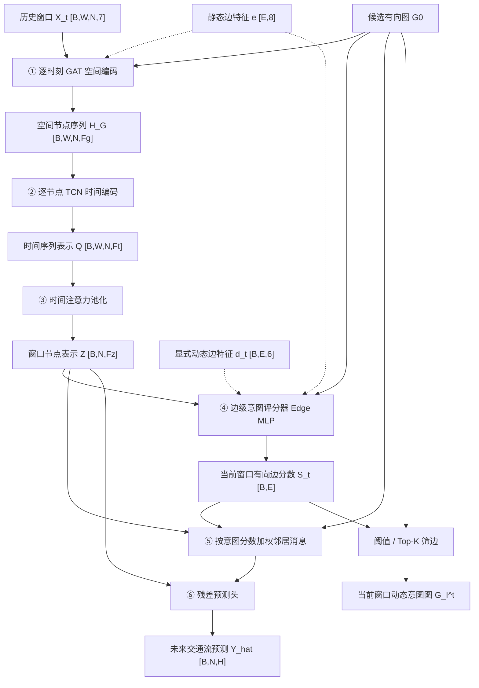

# DEIG-TCN 基线、增量构建与消融实验设计（完整统一版）

> **文档性质**：基于《New Text Document.md》（前半段“意图图”方案）、《02_baselines_and_minimal_model.md》以及已上传的 `persistence.py`、`ridge_ar.py`、`gated_forecaster.py` 整理的**实验设计与模型接口规范**。  
> **状态约定**：**【已有核心代码】**指上传的模型文件覆盖该结构，不等于端到端训练和评估已经全部验证；**【拟新增】**指建议后续开发，不宣称已实现。  
> **研究范围**：本文仅讨论 **DEIG-TCN 的动态边级意图图构建与交通预测部分**，不包括原文后半段的因果—意图融合及传感网部署算法。

---

## 0. 最重要的结论

1. **完整模型的前向顺序不变**：**节点输入 → GAT 空间编码 → TCN 时间编码 → 时间注意力汇总 → 边级意图评分 → 意图加权邻居传播 → 未来流量预测**。动态意图分数还会走一条并行的**意图图构建**分支。
2. **所有 B/M 模型都有相同种类的预测目标**：未来 `H` 步的**节点交通流量** $\hat Y$。只有部分模型额外输出有意义的边分数 $S_t$。
3. **当前意图图不等于未来图预测**。模型使用截至时间 $t$ 的历史窗口，学习面向未来 $H$ 步预测任务的**当前窗口有向边分数** $s_{ij}^{t,H}$，并从中构建 $G_I^t$。
4. **现有 B1–B6 是基础基线/门控控制模型**；其中 **B6 = M0**（同一个简化 DynamicGate-MLP），无需重复训练。M1–M7 是逐步接近原始 DEIG-TCN 的**拟新增**版本。
5. **增量构建不等于严格消融**。M0→M7 观察加入模块后的变化；严格消融要从同一个完整模型出发，每次关闭或替换指定组件。
6. **GAT 和后置意图传播是两次不同的空间信息处理**。前置 GAT 的注意力系数不是最终边级意图分数。

---

## 1. 数据和符号：先明确“输入到底是什么”

### 1.1 统一符号

| 符号 | 含义 | 典型张量形状 |
|---|---|---|
| $B$ | 一批历史窗口的样本数 | — |
| $W$ | 历史窗口长度 | — |
| $N$ | 交通传感器节点数 | — |
| $E=\lvert E_0\rvert$ | 候选有向图中的边数 | — |
| $H$ | 未来预测的步数 | — |
| $F_0$ | 每个节点每个时刻的输入特征维数 | 基础版 1；完整方案 7 |
| $F_g,F_t,F_z$ | GAT、TCN、窗口级节点表示维度 | 可配置 |
| $F_m$ | 邻居消息聚合表示维度 | 可配置 |
| $\mathcal X_t$ | 当前历史窗口的节点输入 | `[B,W,N,F0]` |
| $G_0=(V,E_0)$ | 所有图模型共用的候选有向图 | 边索引 `[E,2]` |
| $\mathbf e$ | 训练期确定的静态边特征 | `[E,8]` |
| $\mathbf d_t$ | 依赖当前窗口的显式动态边特征 | `[B,E,6]` |
| $\mathbf Z_t$ | GAT/TCN 后的窗口级节点表示 | `[B,N,Fz]` |
| $S_t$ | 当前窗口的候选边级意图分数 | `[B,E]` |
| $\hat{\mathbf Y}_t$ | 未来流量预测值 | `[B,N,H]` |

> 本文默认采用 PyTorch 工程里较直观的 `[B,W,N,F]` 排列；原方案公式的 `[W,N,F]` 是省略了批维的单样本写法。边分数也可以借候选图索引还原为 `[B,N,N]`，非候选边设为零。

### 1.2 什么是“1维节点输入”？

“1维”不是只有一个节点或一个历史时刻，而是**每个节点在每个历史时刻只有一个特征：标准化交通流量**：

$
\mathbf f_i^\tau=[z_i^\tau],\qquad
\mathcal X_t\in\mathbb R^{B\times W\times N\times1}.
$

比如历史窗口有 `W` 个时刻，每个节点仍然输入 `W` 个标准化流量，只是每个时刻的特征维度为 `1`。`Persistence` 实际只读取统一预处理后的最近观测值；`Ridge-AR` 和神经模型会读取历史。

### 1.3 完整的 7 维节点输入（M3 开始）

$
\mathbf f_i^\tau=
[z_i^\tau,\ \Delta z_i^\tau,\ r_i^\tau,\
h_{\sin}^\tau,\ h_{\cos}^\tau,\
w_{\sin}^\tau,\ w_{\cos}^\tau].
$

| 维 | 节点特征 | 说明 |
|---|---|---|
| 1 | $z_i^\tau$ | 按训练集统计量标准化的流量 |
| 2 | $\Delta z_i^\tau$ | 该节点流量的一阶变化 |
| 3 | $r_i^\tau$ | 与训练期对应小时/星期周期均值的偏差 |
| 4、5 | 小时 sin、cos | 将一天中的时间位置周期编码 |
| 6、7 | 星期 sin、cos | 将一周中的日期位置周期编码 |

这只是**扩大 GAT 或本地编码器的输入特征**，不是另加七个神经网络模块。

### 1.4 静态边特征和动态边特征

| 类别 | 维数 | 包含哪些信息 | 随当前窗口变化？ | 在完整模型进入哪里？ |
|---|---:|---|---|---|
| 静态边特征 $\mathbf e_{ij}$ | 8 | 距离、距离衰减、方向 cos/sin、训练期 Pearson 相关、训练期时滞相关、最优滞后比例、双向时滞相关差异 | 否 | ① GAT 注意力；② Edge MLP 意图评分器 |
| 显式动态边特征 $\mathbf d_{ij}^t$ | 6 | 窗口内 i→j 时滞关联、双向差异、i/j 异常强度、i/j 近期趋势 | 是 | Edge MLP 意图评分器 |

- **普通 GAT**：使用候选图 $G_0$ 和节点特征算注意力，**不额外喂入**上述 8 维静态边特征。
- **边感知 GAT**：计算注意力时，**额外使用**上述 8 维静态边特征；同样仍依赖候选图。
- **“静态边特征进评分器”**：把 $\mathbf e_{ij}$ 拼入 Edge MLP 的输入；**并不是 StaticGate**。
- **“动态边特征进评分器”**：把 $\mathbf d_{ij}^t$ 拼入 Edge MLP 的输入；**即使不加这 6 维特征，基于窗口节点表示的评分器仍可生成动态分数**。

> 原方案先使用训练数据构建 $G_0$ 与静态特征，并建议基础候选图采用双向 KNN；窗口动态特征只从该窗口及允许的过去数据计算，不能读取未来目标。

---

## 2. 完整 DEIG-TCN：真正的模型执行顺序

### 2.1 完整框图

**关键解释**：从 $S_t$ 分出两条用途不同的支路：一条控制消息传播以改善**未来流量预测**；一条进行阈值/Top-K 筛选，生成**当前窗口**的意图图。两条支路不是“先预测未来图再预测流量”。

### 2.2 完整模型的模块接口表（顺序、输入、输出、粒度）

| 顺序 | 组件 | 主要输入及其粒度 | 输出形状 / 粒度 | 功能与说明 |
|---|---|---|---|---|
| 0 | **节点特征构造** | 原始流量和时间戳；节点×时刻级 | $\mathcal X_t:[B,W,N,7]$；节点-时刻-特征级 | 标准化、变化率、周期残差、时间周期编码 |
| 1 | **候选图与静态边特征构建** | 坐标及训练期历史；节点/边级 | $G_0$、$\mathbf e:[E,8]$；边级 | 候选边、距离、方向、相关与时滞先验 |
| 2 | **GAT 空间编码** | $\mathcal X_t,G_0,\mathbf e$；各历史时刻的节点和边 | $\mathbf H^G:[B,W,N,F_g]$；节点-时刻级 | 在**每个历史时刻**先聚合邻居 |
| 3 | **TCN 时间编码** | $\mathbf H^G$；各节点的历史表示序列 | $\mathbf Q:[B,W,N,F_t]$；节点-时间序列级 | 每个节点沿时间轴使用因果卷积 |
| 4 | **时间注意力池化** | $\mathbf Q$；节点-时间序列级 | $\mathbf Z:[B,N,F_z]$；节点-窗口级 | 综合历史时刻成为**每节点一个窗口向量** |
| 5 | **显式动态边特征构造** | 当前历史窗口流量、变化率、残差；节点-时间级 | $\mathbf d_t:[B,E,6]$；边-窗口级 | 当前窗口时滞、异常、趋势特征；可并行于 2–4 |
| 6 | **Edge MLP 边级意图评分** | 源/目标的 $\mathbf Z$、$\mathbf e$、$\mathbf d_t$、候选边 | $\mathbf S_t:[B,E]$；边-窗口级 | 为当前窗口的各候选**有向边**给出分数 |
| 7 | **意图加权消息聚合** | $\mathbf Z,\mathbf S_t,G_0$；节点-窗口级、边-窗口级 | $\mathbf g_t:[B,N,F_m]$；节点-窗口级 | 按意图边分数决定邻居消息如何影响目标节点 |
| 8 | **未来流量预测头** | $[\mathbf Z\Vert\mathbf g_t]$，最近流量 | $\hat{\mathbf Y}_t:[B,N,H]$；节点-未来步级 | 对每个节点直接预测未来 H 步流量 |
| 9 | **动态意图图构建** | $\mathbf S_t,G_0$；边级 | $G_I^t=(V,E_I^t,A_I^t)$；图级 | 根据相同筛选规则构建当前窗口带权有向图 |
| 10 | **训练损失** | 预测、真值、有效目标掩码、边分数等 | $\mathcal L$；批级标量 | 训练时优化参数；**不是 9 之后的前向网络层** |

> 0、1、5 是数据/特征准备；8、9 是并行输出；10 是训练规则。原始方案还提到可选热点意图子图提取，它是 `G_I^t` 之后的**可选后处理**，不影响上述核心预测与评分骨架。

### 2.3 时间汇总：末端隐藏表示 vs 时间注意力池化

TCN 有整段输出 $\mathbf Q=[q_{t-W+1},\ldots,q_t]$，而 Edge MLP 需要每个节点**一个窗口向量**，故需消除时间轴：

| 方法 | 计算方式 | 是否增加可学习的时间汇总权重？ | 对应实验 |
|---|---|---|---|
| **末端时刻隐藏表示**（last-step） | $\mathbf z_i^t=\mathbf q_{i,t}$ | 否 | M2–M6 |
| **时间注意力池化** | $\mathbf z_i^t=\sum_\tau\beta_{i,\tau}^t\mathbf q_{i,\tau}$ | 是，$\beta$ 通过注意力网络学习 | M7 |
| **时间 MLP** | 将一个节点的历史表示展开并映射成一个窗口向量 | 是，但不是上述逐时刻 attention pooling | B3–M1 |

“取末端隐藏表示”**不等于只读取最后一小时的原始流量**；末端 TCN 隐藏向量可以综合其时间感受野覆盖的多时刻信息。

**公平性提醒**：已上传基础 `CausalTCN` 为两层、核长 3、扩张率 1/2，末端输出的时间感受野仅为 7 个位置。若实验历史长度是 12，建议在 M2–M7 **统一调整 TCN 使感受野覆盖全部历史窗口**，再比较末端读取与注意力池化，否则 M6→M7 可能同时改变可利用的历史范围。

### 2.4 “节点对评分”和“边评分”其实是同一个任务

两者均针对候选有向边 $i\to j$ 产生**一个标量边分数**：

$
s_{ij}^{t,H}=\sigma\!\left(MLP_{edge}(\mathbf m_{ij}^t)\right).
$

区别只在 Edge MLP **使用哪些输入**：

| 评分器版本 | 输入边表示 $\mathbf m_{ij}^t$ | 对应 |
|---|---|---|
| **基础节点对评分** | $[\mathbf z_i,\mathbf z_j,\mathbf z_i-\mathbf z_j,\mathbf z_i\odot\mathbf z_j]$ | B6/M0–M3 |
| **加静态边特征** | 基础节点对 + $\mathbf e_{ij}$ | M4–M5 |
| **再加显式动态边特征** | 基础节点对 + $\mathbf e_{ij}$ + $\mathbf d_{ij}^t$ | M6–M7 |

因此，后续统一称为 **“边级意图评分器（Edge MLP）”**；“节点对评分”只是它使用最少输入的一种版本。

### 2.5 GAT 注意力、时间注意力、意图分数、传播权重不是同一物

| 名称 | 典型符号 | 针对什么计算 | 用于哪里 | 是否是最终意图输出？ |
|---|---|---|---|---|
| GAT 空间注意力 | $\alpha_{ij}^{\tau,l}$ | 历史时刻 $\tau$ 的候选邻居 | 前置 GAT 空间聚合 | 否 |
| 时间注意力 | $\beta_{i,\tau}^t$ | 节点 $i$ 的历史时间位置 | TCN 后的时间汇总 | 否 |
| **边级意图分数** | $s_{ij}^{t,H}$ | 当前窗口候选有向边 $i\to j$ | 构图 + 控制后置聚合 | **是，评分输出** |
| 实际邻居聚合系数 | $\tilde s_{ij}^{t,H}$ 或 $s_{ij}^{t,H}/d_j$ | 邻居消息的数值缩放 | 后置消息聚合 | 取决于归一化规则，不等同原始分数 |

“Gate（门控）”可理解为**控制一条边的消息通过多少的标量权重**；“边特征/边编码”则是计算该标量的输入或中间向量。本文统一采用“边级意图评分器”和“边级意图分数”，避免将 `Gate` 误认为额外独立网络层。

---

## 3. 模型版本总表：B1–B6 与 M0–M7

### 3.1 命名、范围与重复关系

- **B**：基础预测/图消息传播基线。B1–B6 的核心类由已上传的 3 个 Python 文件覆盖。
- **M**：在简化动态边模型上逐步增加组件的**增量构建实验**。
- **B6 = M0**：使用同一份 DynamicGate-MLP 结构、同一数据和同一配置时应视为**同一次实验**；只在两组表格里引用，不重复训练。
- **M7-L0**：结构最完整、但仅采用预测损失的 DEIG-TCN 结构版。
- **M7 + 经验证选定的正则损失**：最终可报告的完整训练方案；不预先断言全部正则一定有益。

### 3.2 总矩阵 A：输入 → 空间 → 时间 → 评分 → 聚合 → 输出（按前向顺序）

| 版本 | 输入 | ① 前置空间编码 | ② 时间编码 | ③ 窗口表示生成 | ④ 边级评分机制 | ⑤ 后置邻居消息 | 主要输出 | 状态 |
|---|---|---|---|---|---|---|---|---|
| **B1 Persistence** | 最后有效流量 | 无 | 不拟合，重复最后值 | 无 | 无 | 无 | $\hat Y$ | 已有核心代码 |
| **B2 Ridge-AR** | `X1` | 无 | 逐节点逐步 Ridge 线性回归 | 线性历史残差映射 | 无 | 无 | $\hat Y$ | 已有核心代码 |
| **B3 Local** | `X1` | 无 | MLP | 历史 MLP 直接输出节点向量 | 无有效边分数（门控 0） | 无 | $\hat Y$ | 已有核心代码 |
| **B4 FixedGraph** | `X1,G0` | 无 | MLP | 历史 MLP | 边权恒为 1 | 固定图聚合 | $\hat Y$、全 1 权重 | 已有核心代码 |
| **B5 StaticGate** | `X1,G0` | 无 | MLP | 历史 MLP | 每条边固定可学习参数 | 静态边权聚合 | $\hat Y,S_{\rm static}$ | 已有核心代码 |
| **B6 / M0 DynamicGate** | `X1,G0` | 无 | MLP | 历史 MLP | 动态节点对 Edge MLP | 动态边权聚合 | $\hat Y,S_t$ | 已有核心代码 |
| **M1** | `X1,G0` | **逐时刻普通 GAT** | 时间 MLP | GAT 历史序列由 MLP 汇总 | 动态节点对 Edge MLP | 动态边权聚合 | $\hat Y,S_t$ | 拟新增 |
| **M2** | `X1,G0` | 普通 GAT | **TCN** | **末端 TCN 隐藏表示** | 动态节点对 Edge MLP | 动态边权聚合 | $\hat Y,S_t$ | 拟新增 |
| **M3** | `X7,G0` | 普通 GAT | TCN | 末端 TCN 隐藏表示 | 动态节点对 Edge MLP | 动态边权聚合 | $\hat Y,S_t$ | 拟新增 |
| **M4** | `X7,G0,e` | 普通 GAT（**暂不吃 e**） | TCN | 末端 TCN 隐藏表示 | Edge MLP 加**静态边 e** | 动态边权聚合 | $\hat Y,S_t$ | 拟新增 |
| **M5** | `X7,G0,e` | **边感知 GAT（吃 e）** | TCN | 末端 TCN 隐藏表示 | Edge MLP 吃 e | 动态边权聚合 | $\hat Y,S_t$ | 拟新增 |
| **M6** | `X7,G0,e,d_t` | 边感知 GAT | TCN | 末端 TCN 隐藏表示 | Edge MLP 吃 **e+d_t** | 动态边权聚合 | $\hat Y,S_t$ | 拟新增 |
| **M7 Full-Structure** | `X7,G0,e,d_t` | 边感知 GAT | TCN | **时间注意力池化** | Edge MLP 吃 e+d_t | 动态边权聚合 | $\hat Y,S_t$ | 拟新增 |

约定：`X1=[B,W,N,1]`；`X7=[B,W,N,7]`；`e=[E,8]`；`d_t=[B,E,6]`。**所有 B/M 版本均以未来节点流量为预测任务；边分数是额外的模型输出或控制信号。**

### 3.3 总矩阵 B：组件开关与替换（便于写 YAML/配置表）

符号：`✓` 使用；`—` 不使用；`MLP` 表示替代 TCN 的历史 MLP；`末端` 表示 TCN 最后隐藏位置；`注意力` 表示时间注意力池化。

| 版本 | GAT | TCN | 7维节点输入 | e进GAT | e进评分器 | d进评分器 | 时间汇总 | 后置图消息 | 边权类型 |
|---|---|---|---|---|---|---|---|---|---|
| B1 | — | — | — | — | — | — | 不适用 | — | 无 |
| B2 | — | — | — | — | — | — | 不适用 | — | 无 |
| B3 | — | — | — | — | — | — | MLP | — | 无 |
| B4 | — | — | — | — | — | — | MLP | ✓ | 全1 |
| B5 | — | — | — | — | — | — | MLP | ✓ | 静态可学习 |
| B6 = M0 | — | — | — | — | — | — | MLP | ✓ | 动态 |
| M1 | ✓ | — | — | — | — | — | MLP | ✓ | 动态 |
| M2 | ✓ | ✓ | — | — | — | — | 末端 | ✓ | 动态 |
| M3 | ✓ | ✓ | ✓ | — | — | — | 末端 | ✓ | 动态 |
| M4 | ✓ | ✓ | ✓ | — | ✓ | — | 末端 | ✓ | 动态 |
| M5 | ✓ | ✓ | ✓ | ✓ | ✓ | — | 末端 | ✓ | 动态 |
| M6 | ✓ | ✓ | ✓ | ✓ | ✓ | ✓ | 末端 | ✓ | 动态 |
| M7 | ✓ | ✓ | ✓ | ✓ | ✓ | ✓ | 注意力 | ✓ | 动态 |

> **切勿把 B4 的“全 1”或 B5 的“静态可学习”理解为 e 特征**。B4/B5 的边权形式与是否显式输入静态边属性是两个不同维度。

### 3.4 增量构建的相邻比较及科学问题

| 对照 | 主要增加/替换的能力 | 问题与解释边界 |
|---|---|---|
| B1 → B2 | 从最后值复制到 Ridge-AR | 简单线性历史规律能否有收益；属于**不同模型族比较** |
| B2 → B3 | Ridge → 共享节点 MLP | 非线性本地建模是否有价值；不属于严格单组件消融 |
| B3 → B4 | 启用固定图消息 | 邻居信息是否有价值 |
| B4 → B5 | 全 1 → 静态可学习边权 | 静态边筛选是否有价值 |
| B5 → B6/M0 | 静态 → 窗口动态评分 | 动态边关系是否有价值 |
| M0 → M1 | 在历史 MLP 前加入逐时刻 GAT | 前置空间编码的增量价值 |
| M1 → M2 | 时间 MLP 换成 TCN | 时间卷积的增量价值 |
| M2 → M3 | 节点输入 1→7 维 | 节点变化率、周期等附加特征的作用 |
| M3 → M4 | e 进入 Edge MLP | 边静态先验对意图评分的作用 |
| M4 → M5 | e 进入 GAT 注意力 | 边感知 GAT 的附加价值 |
| M5 → M6 | d 进入 Edge MLP | 显式窗口关系、异常、趋势对评分的作用 |
| M6 → M7 | 末端读取改为时间注意力池化 | 自适应历史汇总的附加价值 |

**开发顺序与执行顺序不同**：M1 是把 GAT 插在时间 MLP 的**前面**；M2 是让前置 GAT 的历史输出进入 TCN。**不是先执行 TCN 再执行 GAT。**

---

## 4. 每一种模型究竟“输出”什么？

### 4.1 所有模型都输出未来流量；边分数能力有所不同

| 模型组 | 预测输出 $\hat Y:[B,N,H]$ | `edge_scores` / $S$ | 能构成哪种图？ | 是否有有意义的边高低排名？ |
|---|---|---|---|---|
| B1 Persistence | ✓ | 无 (`None`) | 无学习图 | 否 |
| B2 Ridge-AR | ✓ | 无 (`None`) | 无学习图 | 否 |
| B3 Local | ✓ | 无 (`None`；形式上所有门控 0) | 无学习图 | 否 |
| B4 FixedGraph | ✓ | 所有候选边全 1 | 原候选图 $G_0$ | **否，所有边并列** |
| B5 StaticGate | ✓ | 每边一个固定、可学习的分数 | 静态带权图 | 是，但排名不随窗口变化 |
| B6/M0–M7 | ✓ | 每窗口每候选边一个动态分数 | 可筛选 $G_I^t$ | 是，可进一步检验是否有预测价值 |

**注意**：“可构成动态意图图”是指具有筛图所需的动态边分数，并不等于现有三个 Python 文件已经完成了所有模型的图后处理和导出。

### 4.2 最终结果、中间结果、模型输入的区别

| 名称 | 形状 | 类别 | 意义 |
|---|---|---|---|
| $\mathcal X_t$ | `[B,W,N,F0]` | **输入** | 历史窗口的节点特征 |
| $G_0,\mathbf e,\mathbf d_t$ | 边索引、`[E,8]`、`[B,E,6]` | **先验/派生输入** | 候选边及其统计/窗口特征 |
| $\alpha_{ij}^{\tau,l}$ | 各历史时刻候选边上的权重 | **中间变量** | GAT 空间注意力 |
| $\mathbf Q$ | `[B,W,N,Ft]` | **中间变量** | TCN 时间序列隐藏表示 |
| $\beta_{i,\tau}^t$ | `[B,W,N]`（概念表示） | **中间变量** | 时间注意力池化权重 |
| $\mathbf Z_t$ | `[B,N,Fz]` | **中间变量** | 窗口级节点表示 |
| $\mathbf g_t$ | `[B,N,Fm]` | **中间变量** | 意图加权邻居聚合结果 |
| $\hat{\mathbf Y}_t$ | `[B,N,H]` | **主要模型输出** | 未来各节点流量 |
| $\mathbf S_t$ | `[B,E]` | **额外模型输出** | 当前窗口对预测任务有用的有向边分数 |
| $G_I^t$ | 节点、保留边、保留权重 | **构图后处理输出** | 当前窗口的带权动态意图图 |

**分数并不直接等于真实因果效应或精确预测贡献**：缺少边级真值监督时，需要用删除实验、预测误差变化、跨窗口结构分析来验证其任务相关性。

---

## 5. “意图传播”到底在做什么？

它的准确名称可以写成 **“后置边分数加权邻居消息聚合”**，是第二次空间消息传递，而不是预测未来的图。

设窗口级节点表示为 $\mathbf z_i^t$，模型得到一条候选有向边的分数 $s_{ij}^{t,H}$ 后，邻居 $i$ 的消息为 $W_m\mathbf z_i^t$，被边分数缩放，再汇总到目标节点 $j$：

$
\mathbf g_j^t
=\sum_{i:(i,j)\in E_0}w_{ij}^tW_m\mathbf z_i^t.
$

其中 $w_{ij}^t$ 是**用于消息传播的实际权重**；不一定等于原始分数 $s_{ij}^{t,H}$。然后预测头综合自身表示与邻居消息：

$
\hat{\mathbf y}_j^{t}
=\bar z_j^t+\operatorname{MLP}_{pred}
\big([\mathbf z_j^t\Vert\mathbf g_j^t]\big).
$

这里采用便于短时交通流预测的残差形式；残差输出是未来 $H$ 步向量。

**为什么 B1–B3 没有这一组件？** 因为它们只用自身最后值或自身历史；B4 开始才使用候选图进行邻居聚合，B5/B6 再逐渐加入静态/动态的边权学习。

### 5.1 两种不等价的消息归一化，必须先确定主实验协议

**原始《意图图》方案：入边分数和归一化**

$
w_{ij}^t
=\frac{s_{ij}^{t,H}}
{\sum_{p:(p,j)\in E_0}s_{pj}^{t,H}+\varepsilon}.
$

**已上传六模型代码：固定候选入度归一化**

$
w_{ij}^t
=\frac{s_{ij}^{t,H}}{\max(1,d_j)},
\qquad d_j=|\{i:(i,j)\in E_0\}|.
$

| 性质 | 入边分数和归一化（原方案） | 固定入度归一化（六模型代码） |
|---|---|---|
| 分数相对大小影响邻居权重 | 是 | 是 |
| 全体入边分数同比缩小时，消息总幅度是否同比缩小 | **通常不会**（忽略 $\varepsilon$） | **会** |
| 与平均原始边分数的稀疏损失是否可能形成缩放退化 | 较容易 | 有所缓解，但非完全消除 |
| 是否等于原方案的公式 | 是 | **否，属于修改后的实现协议** |

**建议**：为了专门考察“门控强弱”，可以以**固定入度归一化**作为主实验协议，并把原方案归一化单独做对照；但论文应明确标注这一修改，不能宣称未修改原始公式。无论选哪种，B4–M7 的同类对照须保持一致。

---

## 6. 严格消融：从相同的 M7 母模型出发

以下先以 **M7-L0（仅预测损失）**为共同母模型，避免把不同结构损失同时混入架构消融。

### 6.1 结构模块消融矩阵

符号：✓ 保留；— 删除；“替换”表示改变对应模块但保留接口形状。

| 版本 | GAT | TCN | 7维节点输入 | e进GAT | e进评分器 | d进评分器 | 时间注意力 | 后置意图消息 | 输出重点 |
|---|---|---|---|---|---|---|---|---|---|
| **Full M7-L0** | ✓ | ✓ | ✓ | ✓ | ✓ | ✓ | ✓ | ✓ | $\hat Y,S_t$ |
| w/o GAT | — | ✓ | ✓ | — | ✓ | ✓ | ✓ | ✓ | $\hat Y,S_t$ |
| w/o TCN | ✓ | **替换为逐时刻特征映射** | ✓ | ✓ | ✓ | ✓ | ✓ | ✓ | $\hat Y,S_t$ |
| w/o Extra Node Features | ✓ | ✓ | —（仅流量） | ✓ | ✓ | ✓ | ✓ | ✓ | $\hat Y,S_t$ |
| w/o e in GAT | ✓ | ✓ | ✓ | — | ✓ | ✓ | ✓ | ✓ | $\hat Y,S_t$ |
| w/o e in Edge MLP | ✓ | ✓ | ✓ | ✓ | — | ✓ | ✓ | ✓ | $\hat Y,S_t$ |
| w/o d in Edge MLP | ✓ | ✓ | ✓ | ✓ | ✓ | — | ✓ | ✓ | $\hat Y,S_t$ |
| w/o Temporal Attention | ✓ | ✓ | ✓ | ✓ | ✓ | ✓ | —（末端读取） | ✓ | $\hat Y,S_t$ |
| w/o Intent Message | ✓ | ✓ | ✓ | ✓ | 不训练或另设监督 | 不训练或另设监督 | ✓ | — | **主要仅 $\hat Y$** |

**依赖关系与解释**：

- `w/o GAT` 不等于 `Local`：它仍保留 TCN、意图评分和**后置意图消息**，因此仍可利用邻居。
- `w/o TCN` 时要维持时间注意力的输入接口；可让 GAT 的逐时刻表示经过逐时刻线性/MLP 投影再池化。它是“**无时间卷积**”，不是“完全不建模时间”。
- `w/o Extra Node Features` 只把**输入到 GAT 的节点特征**恢复为流量；下游用于构造显式动态边特征的历史数据不应无说明地一起删除。
- `w/o Intent Message` 如果只靠预测损失训练，边评分器将失去通向预测任务的学习路径；因此不要继续把它的未受监督边分数当成有效解释输出。

### 6.2 同一 GAT-TCN 骨架上的边评分方式消融

| 版本 | 前置 GAT-TCN | 边分数如何产生 | 后置消息聚合 | 可输出什么 |
|---|---|---|---|---|
| No Intent Message | ✓ | 不需要评分器 | — | 未来流量 |
| Fixed Intent | ✓ | 所有候选边恒为 1 | ✓ | 流量、全 1 权重 |
| Static Intent | ✓ | 每条候选边固定参数经 sigmoid | ✓ | 流量、静态边分数 |
| Dynamic Intent | ✓ | Edge MLP 从窗口节点表示和边特征动态评分 | ✓ | 流量、动态边分数 |

这组实验更直接对应你的核心主张——**随窗口变化的意图边分数究竟有无价值**。建议尽可能匹配候选图、编码器、后置聚合归一化与预测头；参数规模差异需要报告。

> 可选附加试验：`TCN → GAT` 与主模型的 `GAT → TCN` 做**结构顺序比较**。不放进 M0–M7 主链，因为“模块存在与否”和“顺序优劣”是不同问题。若做顺序对比，两边应尽量保留相同的逐时刻空间处理和时间汇总条件。

---

## 7. L0–L4：结构固定，单独比较损失函数

这里默认全部采用 **M7 的相同网络结构、候选图和输入特征**。

| 配置 | 预测损失 $\mathcal L_{pred}$ | 稀疏 $\mathcal L_{sparse}$ | 方向 $\mathcal L_{dir}$ | 时间平滑 $\mathcal L_{temp}$ | 用途 |
|---|---|---|---|---|---|
| **L0** | ✓ | — | — | — | 无边级监督时的最简训练目标 |
| **L1** | ✓ | ✓ | — | — | 单独验证稀疏约束 |
| **L2** | ✓ | — | ✓ | — | 单独验证方向约束 |
| **L3** | ✓ | — | — | ✓ | 单独验证平滑约束 |
| **L4** | ✓ | ✓ | ✓ | ✓ | 验证联合约束是否额外有益 |

$
\mathcal L =
\mathcal L_{pred}
+\lambda_s\mathcal L_{sparse}
+\lambda_d\mathcal L_{dir}
+\lambda_t\mathcal L_{temp}.
$

- **L1–L3 都是相对 L0 独立增加一个损失**，不是按行累加；L4 才把它们组合。
- 稀疏损失作用在**原始边分数**上，需结合消息归一化机制检查是否有“分数整体缩小却不影响预测”的退化。
- 方向约束不能把真实存在的双向关系强行压成单向；时间平滑不能抑制真正的突变。
- 若使用时间平滑损失，样本必须有可对齐的相邻窗口，且比较窗口不得跨越不允许的数据分割边界。
- 原方案的**可选距离损失**可以放在补充实验；原文只提出、尚未写成明确可执行训练定义的**弱监督辅助/贡献蒸馏**不强行纳入第一版 L4。
- **最终完整训练版本不必等于 L4**：以验证集结果和意图图忠实度选择合理损失组合。

---

## 8. 评价指标：不能只看预测 MAE

| 评价层面 | 适用模型 | 结果/指标 | 应回答的问题 |
|---|---|---|---|
| 未来交通预测 | **全部 B/M 模型** | MAE、RMSE、不同预测步的误差、相对 Persistence 的 Skill | 模型是否真的改善预测 |
| 边分数预测忠实度 | B5、B6/M0–M7 | Top-K 高分边删除 / 随机边删除 / 低分边删除后的误差变化 | 排名靠前的边是否更影响预测 |
| 时变结构 | B6/M0–M7 | 相邻窗口 Top-K 重合、得分变化、异常窗口前后变化 | 关系是否随窗口变化且具有任务关联 |
| 结构特征 | B5–M7 | 激活比例、双向权重差异、空间分布、分数直方图 | 图是否稀疏、合理、有方向性 |
| 参数与效率 | 所有训练模型 | 参数量、训练时间、推理成本 | 新增模块的代价是否值得 |
| 完整模型 GAT 与后置传播的边干预 | M1–M7 | 仅关后置意图消息；再对照同时关前置 GAT 对应边 | 区分两条空间传播路径的贡献 |

**不能误报的实验结果**：

1. B4 全 1 权重不存在有意义的 Top-K 排序；B5 静态边分数的窗口 Top-K 完全一致是定义结果，不应作为“优秀动态稳定性”。
2. GAT 注意力不等于边级意图分数。
3. 高分边删除后误差变化可以提供**模型内任务忠实度证据**，但不能直接称为观测交通的真实因果效应。
4. 测试集不得用于选择结构、阈值、正则权重或最佳实验版本。

---

## 9. 数据、训练、保存与可复现实验协议

| 项目 | 应固定的做法 | 特别注意 |
|---|---|---|
| 样本与划分 | 时间顺序训练/验证/测试；一致的节点、W、H 与目标窗口 | 原方案提出按窗口时间顺序约 60%/20%/20%；注意窗口跨边界的历史与标签隔离 |
| 数据标准化 | 仅用训练期确定均值、方差、周期统计 | 不得用验证/测试未来段更新训练期统计 |
| 缺失值 | 各模型使用一致的因果可获得填补输入 | 不应在某模型中额外读取未来值或完整序列插值 |
| 候选图 | 所有用图版本使用相同 $G_0$ | 如采用双向 KNN，应固定 K、构图算法与节点顺序 |
| 归一化方式 | 在主实验开始前选定并保持一致 | 原文与现有六模型代码不同，见 §5.1 |
| 神经训练协议 | 同类模型尽量共享损失掩码、优化器、早停、种子/重复次数 | 记录不同模型实际可训练参数量 |
| 时间感受野 | M2–M7 使用一致、覆盖目标历史的 TCN 设置 | 不应 M7 覆盖更多历史而 M6 覆盖更少 |
| 评价目标 | 完整测试集，采用统一目标掩码及反标准化约定 | Persistence 是基线和 Skill 参考，不能用旧运行记录替代 |
| 构图后处理 | 固定分位数/Top-K 或在验证集确定阈值 | 同一测试比较中不能按模型或测试集任意改阈值 |
| 结果保存 | 预测、真实值、目标掩码、边索引、边分数、模型配置、随机种子 | 确保边索引方向 i→j 与评分数组完全对齐 |

### 建议统一的模型接口

| 接口字段 | 形状 | B1–B3 | B4 | B5 | B6/M0–M7 |
|---|---|---|---|---|---|
| `prediction` | `[B,N,H]` | 必有 | 必有 | 必有 | 必有 |
| `edge_scores` | `[B,E]` 或 `None` | `None` | 全 1 | 静态、按 batch 广播 | 动态 |
| `candidate_src / candidate_dst` | `[E]` | 可不需要 | 必须 | 必须 | 必须 |
| `intent_graph`（可选后处理） | 边列表、边权、阈值 | 不适用 | 原图 | 静态图 | 各窗口动态图 |
| `effective_weight`（诊断） | `[B,E]` | `None` | 可输出 | 可输出 | 可输出 |

对于 `edge_scores`，**保留原始边分数**；如果同时提供归一化后的消息系数，用 `effective_weight` 等独立字段存储，不要覆盖原始分数。

---

## 10. 与目前已上传 Python 代码的对应关系

| 已上传文件 / 类 | 覆盖模型 | 已有的关键机制 | 尚不能仅凭当前文件确认或完成的工作 |
|---|---|---|---|
| `persistence.py` / `Persistence` | B1 | 最近有效值直接复制到 H 步、无边分数 | 完整实验评价依赖外部数据与评估流程 |
| `ridge_ar.py` / `RidgeAR` | B2 | 逐节点逐 horizon 直接残差 Ridge、SVD 求解、验证 MAE 选正则 | 默认候选正则与原文要求有差异，需显式配置 |
| `gated_forecaster.py` / `ForecastModule`、`GatedForecaster` | B3–B6/M0 | MLP/可选节点独立 TCN；无前置 GAT；静态/动态边权；固定入度消息聚合；残差预测头 | GAT、e/d 边特征注入、时间注意力池化、M1–M7 组件、完整构图后处理需新增 |
| 外部训练/数据/注册模块（未在这批模型文件中） | 全模型实验 | 模型类通过外部训练器与批数据运行 | 早停、初始轮选模、有效掩码、完整测试、实验运行入口需进一步核对 |

**重要实现修正**：

- `RidgeAR` 如不传 `alpha_candidates`，当前代码只使用默认 `alpha=1.0`；原基线文档要求 $\{0.01,0.1,1,10\}$ 并依据完整验证目标选取，应在运行配置中明确传入候选集合。
- 当前 TCN 直接取末端序列输出；实现 M7 必须使时间编码器能够**返回完整时间序列**，然后接时间注意力池化。
- 现有六模型代码的 Local 无前置 GAT 且没有后置图消息，M1–M7 一旦有前置 GAT，即使关掉后置传播，也不等于完全“不使用邻居”。
- 当前上传的模型文件尚不等同于已验证的端到端 M1–M7 实验实现。

---

## 11. 推荐的实验执行顺序与论文组织

| 阶段 | 版本 | 论文/实验应支持的主要结论 |
|---|---|---|
| A. 基础基线 | B1–B6（B6=M0） | 从无学习、线性/非线性本地模型，到固定图、静态边、动态边控制的差异 |
| B. 逐步构建 | M0–M7 | GAT、TCN、节点/边特征、时间注意力分别是否带来增益 |
| C. 完整结构消融 | 以 M7-L0 为母模型的 w/o/替换矩阵 | 新增模块在**完整模型背景下**是否仍必要 |
| D. 动态意图机制消融 | No / Fixed / Static / Dynamic Intent | 动态意图边关系是否比简单图传播更有预测价值 |
| E. 损失目标消融 | M7-L0 至 L4 | 结构正则能否在不牺牲合理预测的情况下改善意图图 |
| F. 意图图忠实度与结构分析 | 边删除、时变与图统计 | 边分数是否是有用的预测相关排序，而非随意的装饰性权重 |

**建议优先完成的三组核心对照**：

1. **B5 vs B6/M0**：保持无前置 GAT 的预测骨架，比较静态与动态门控。
2. **M1 vs M2**：保持前置 GAT 与动态意图评分器，比较时间 MLP 与 TCN。
3. **相同 GAT-TCN 骨架下的 Static Intent vs Dynamic Intent**：在更完整的时空编码条件下，直接验证动态意图评分机制。

若主要创新是边级意图识别，**第三组加上边删除忠实度**比简单追求更多深层模块更重要。

---

## 12. 最终术语表（建议所有实验代码、图和论文保持一致）

| 推荐名称 | 不建议混用的说法 | 规范含义 |
|---|---|---|
| **节点输入特征** | “节点数量”“节点维度”等未限定说法 | 每个节点每个时刻的流量/变化率/周期等输入变量 |
| **候选有向图 $G_0$** | “学习出来的意图图” | 预先确定允许计算和传播的候选边集合 |
| **GAT 空间编码器** | “最终意图模型” | 在每个历史时刻对候选邻居进行空间注意力聚合 |
| **TCN 时间编码器** | “动态边权模型” | 沿时间轴编码历史时空表示，不自动学习最终意图分数 |
| **窗口级节点表示** | “最后原始观测值” | 时间编码/汇总后每节点一个隐藏向量 |
| **时间注意力池化** | “GAT 注意力”“意图分数” | 对历史时间位置做加权汇总 |
| **边级意图评分器 Edge MLP** | “节点对评分器”“静态边 Gate” | 对候选有向边计算随窗口变化的任务相关分数 |
| **原始边级意图分数 $S_t$** | “准确因果效应”“未来图标签” | 当前窗口面向预测目标的模型边评分 |
| **后置意图加权消息聚合** | “预测未来图”“意图图输出层” | 用边分数控制邻居消息，辅助预测 |
| **当前窗口动态意图图 $G_I^t$** | “未来 $t+H$ 图预测” | 由当前窗口的边分数与候选图筛选所得 |
| **M0–M7 增量构建** | “严格单组件消融” | 观察由简到繁的开发与收益变化 |
| **Full-M7 w/o 消融** | “从 B1 一直逐层消融” | 以固定完整模型为母体，关闭/替换指定组件 |

---

## 13. 仍需在正式训练前确定的事项（不要默认为已实现）

1. **主要的消息归一化协议**：忠于原方案的分数和归一化，还是六模型代码使用的固定入度归一化。
2. **TCN 架构一致性**：感受野需覆盖实验历史窗口；M2–M7 应固定相同卷积结构。
3. **时间 MLP 的准确实现**：M1 如何将逐时刻 GAT 表示汇总为窗口节点向量（建议沿时间与通道展开，经共享 MLP 映射）。
4. **意图图构建阈值**：固定阈值、分位数或 Top-K；如何处理并列、不同边数和无激活边。
5. **完整训练器与数据协议**：训练/验证/测试边界、掩码、缺失值、随机种子、早停和多次独立运行。
6. **是否需要原方案之外的消融**：例如反向 `TCN→GAT` 顺序比较，可列为扩展，不是 M0–M7 的必要项。

---

## 附：原始依据与修订范围

**原始依据（用户上传）**

- `New Text Document.md`：意图图方案，重点为节点/边特征、候选图、GAT、TCN、时间注意力、边级意图识别、后置加权预测与损失约束。
- `02_baselines_and_minimal_model.md`：B1–B6 的数学基线定义，及不含前置 GAT、固定候选入度聚合等设计。
- `persistence.py`、`ridge_ar.py`、`gated_forecaster.py`：已上传的基线核心代码。

**本文明确属于建议/修订的内容**

- B/M/L 统一实验编号、M1–M7 的逐步构建、严格消融矩阵、统一输出/评价接口。
- 采用固定入度归一化作为**候选主协议**的建议（与原方案不同）。
- 在全部 TCN 版本中保证充分历史感受野、统一时间汇总接口的实现建议。
- 无监督意图分数的忠实度评价与严格边干预实验要求。

> **一句话总结**：DEIG-TCN 的重点不是“预测一张未来图”，而是从历史流量中学习**当前窗口中与未来流量预测有关的动态有向边分数**；使用这些分数改善节点未来流量预测，再把边分数转化为可分析的动态意图图。
