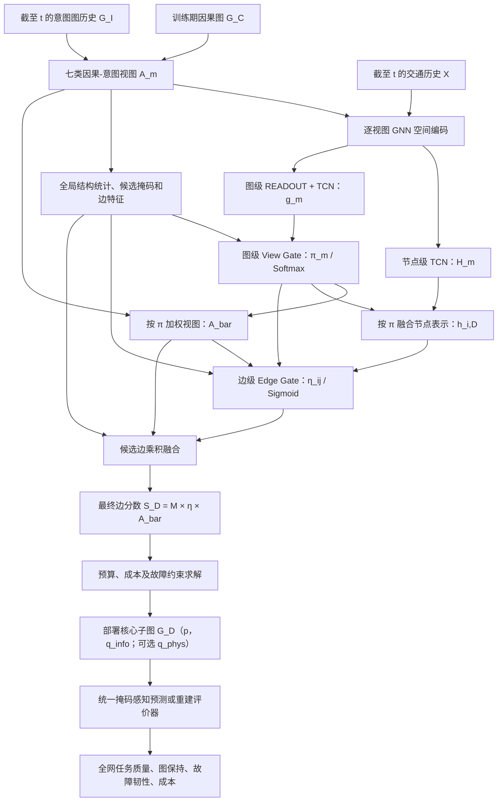

# RA-TCGF 因果–意图融合与弹性核心子图部署：两级门控版实验设计（递进构建与严格消融）

> **文档定位**：DEIG-TCN 后续第二阶段的**拟定实验方案**。依据用户上传《New Text Document.md》中“因果–意图融合”部分的 RA-TCGF 定义，并补充可执行的基线、消融、任务评价与故障实验协议。除明确注明“原方案”之处外，实验编号、评价公式、在线部署修订和训练接口均为**建议设计**，不代表已有工程代码已实现。  
> **关联研究**：第一阶段 DEIG-TCN 学习当前窗口的动态意图边分数/意图图；第二阶段 RA-TCGF 将其与训练期因果图融合，输出预算约束下可调整的动态核心部署子图。
>
> **版本说明（两级门控修订）**：本版本将原先的“图级视图偏好 → 节点 ego-graph 视图偏好 → 边级视图偏好”改为仅保留两类可学习门控：**Global View Gate** $\pi_m^t$（全图决定哪个视图更重要）和 **Local Edge Gate** $\eta_{ij}^t$（对每条候选有向边给出一个重要性标量）。节点 ego-graph 权重与旧版边级七维视图偏好不再作为模型模块。**这是拟定实验设计，不代表已完成代码实现和真实数据实验。**

> **实验组织原则**：第 2 节只记录**基线与逐层新增组件**（R0/R1 为两条单来源起点，R2 开始合流）；第 3 节只记录**以完整 R12 为母体的严格删除实验**。不再设置另立编号的单来源完整模型章节，也不把消融试验混入逐层构建表。完整两级门控模型为 `R12`，求解器实验另按 `O0–O3` 比较。

---

## 0. 目标、边界与三个先决问题

**核心目标**不是复现第一阶段的未来流量预测网络，而是：

$
(G_C,\ G_I^{\le t},\ X_{\le t},\ \text{预算/部署约束})
\longrightarrow S_D^t \longrightarrow G_D^t,
$

其中 $S_D^t$ 是融合边分数，$G_D^t$ 是节点与边的部署决策图。**未来流量预测或网络状态重建**是评价该部署决策是否有用的下游任务，不是必须由融合网络自身再次直接输出的张量。

### 0.1 首先区分三个不同的图

| 名称 | 符号 | 边代表什么 | 主要用途 | 是否可直接视为物理可部署链路？ |
|---|---|---|---|---|
| 因果/条件依赖图 | $G_C$ | PCMCI 等识别的具有方向和时滞的统计/因果候选关系；因果解释依赖方法假设 | 稳态骨架和兜底先验 | **否** |
| 预测任务意图图 | $G_I^t$ | DEIG-TCN 提取的当前窗口边级预测相关性 | 热点、动态任务信息 | **否** |
| 物理/通信可行图（若有） | $G_{\rm phys}$ | 能铺设线路、实际通信或实现传感器连接的物理可行关系 | 物理连通性、链路成本与故障 | **是，经过可行性验证后** |

最后的 $G_D^t$ 必须进一步说明是**“选择哪些传感器 + 保留哪些信息依赖边”**，还是同时包含**“选择物理通信链路”**。若没有 $G_{\rm phys}$，只应宣称**信息/预测任务鲁棒性**，不要把统计依赖图的连通性当作实际通信可靠性。

### 0.2 在线部署必须避免未来信息泄漏

原文写了 $G_I^{t+r}$、$p_I^{t,+}$、$d_I^{t,+}$ 等未来意图信息。这可以用于**事后离线分析/先知上界**，但在时间 $t$ 执行在线部署时不可用。

**建议主协议**：
- 只使用截至 $t$ 的历史图序列 $[G_I^{t-L+1},\ldots,G_I^t]$；简化三窗口可用 $[G_I^{t-2r},G_I^{t-r},G_I^t]$。
- 删除主模型的前瞻 $p_I^{t,+},d_I^{t,+}$；时间“持续/新增/消退”都与过去窗口比较。
- 原文结构统计向量含 9 项，其中 2 项直接依赖未来；删除后可使用 **7 项因果可得结构统计**（或另行定义过去两步的替代指标，但需写明）。
- 若保留前瞻版本，命名为 **Offline-Oracle（只做上界、不可与在线基线混称）**。

### 0.3 原文的部署效用在测试决策时不能读取 $Y_t$

原文 $U_{pred}=-\ell(\hat Y_t^{G(p,q)},Y_t)$、$U_{elastic}=-\mathbb E_\delta \ell(\hat Y_t^{G(p,q)\setminus\delta},Y_t)$ 包含真实未来目标 $Y_t$。

- **训练**时，可使用训练窗的 $Y_t$ 构造损失或任务增益监督。
- **验证**时，可使用验证集真值做模型/超参选择和最终评估，但不要把某一验证窗的未来真值作为该窗模拟“在线部署”算法的运行时输入。
- **测试部署决策**时，只能读取实时可用信息，使用训练阶段得到的**效用代理/可学习评分器**选图，测试真值只在**决策固定以后**用于计分。
- **离线真值优化**只能列为 “Oracle” 上界，不应作为可实际部署方案。

---

## 1. 完整 RA-TCGF 的执行顺序与输入输出

### 1.1 核心符号

| 记号 | 含义 | 张量/结构形状 |
|---|---|---|
| $B_s$ | 样本批次维度，与预算 $B_{\rm budget}$ 区分 | 标量 |
| $L$ | 可用历史图/交通状态序列长度 | 标量 |
| $N$ | 已知候选传感器节点数 | 标量 |
| $E_U^t$ | 当前时刻**信息候选有向边**集合；只能由训练期因果图和截至 $t$ 的意图图历史确定 | 集合 |
| $E_U$ | 本批次稀疏候选边数；变长时填充并使用有效掩码 | 标量 |
| $K_v=7$ | 全部可选视图 C、I、CI、R、C\I、P、N 的数量 | 标量 |
| $A_C$ | 统一方向、节点 ID 和尺度的非负因果权重 | `[N,N]` |
| $A_I^\tau$ | 意图有向边权（仅 $\tau\le t$ 可在线访问） | `[N,N]` |
| $A_m^\tau$ | 第 $m$ 个视图的非负权重 | `[Bs,L,E_U]`（稀疏） |
| $M_U^t$ | 当前候选边有效掩码；非候选边禁止被门控“创造” | `[Bs,E_U]` 或 `[N,N]` |
| $X_{\le t}$ | 允许访问的交通历史状态 | `[Bs,L,N,F_x]` |
| $H_m^t$ | 第 $m$ 个视图下的节点时空表示 | `[Bs,N,d_h]` |
| $g_m^t$ | 第 $m$ 个视图下的图级时空表示 | `[Bs,d_g]` |
| $\boldsymbol\pi^t$ | **唯一的图级门控**，跨视图 Softmax 权重 | `[Bs,K_v]` |
| $\bar A^t$ | 由 $\pi$ 对多个视图加权得到的**中间融合图** | `[Bs,E_U]` |
| $h_{i,D}^t$ | 使用 $\pi$ 融合的节点 $i$ 的多视图表示 | `[Bs,d_h]` |
| $\boldsymbol\eta^t$ | **唯一的边级门控**，每条有向边一个 Sigmoid 标量 | `[Bs,E_U]` |
| $S_D^t$ | 两级门控后的动态融合边分数 | `[Bs,E_U]` 或 `[Bs,N,N]` |
| $p^t$ | 被选择/激活的传感器节点 | `[Bs,N]`，二值 |
| $q_{\rm info}^t$ | 保留的信息依赖边（不自动代表物理线路） | `[Bs,E_U]`，二值 |
| $q_{\rm phys}^t$ | 若有物理可行图，单独定义的物理链路选择 | 物理边二值向量 |
| $G_D^t$ | 预算内最终部署/保留节点与信息边 | 图与部署元数据 |

**有向约定必须固定：** 所有融合邻接矩阵一律采用 $A[i,j]\equiv i\rightarrow j$。原始因果张量若为 **[target, source, lag]**，必须完成轴转换与时滞聚合；意图 `.npz` 的 `edges_list` 为 **[src, dst]**，不能未经转换直接重叠。方向为**统计/预测依赖方向**，不等同于道路车辆的实际行驶方向。

**候选边集合约束：** $E_U^t$ 建议取训练期因果候选与截至 $t$ 的意图候选并集，并按当前窗口更新。不应仅因为物理链路可用就将其误作为信息关系；若需要物理部署约束，另用 $G_{\rm phys}$。所有输入视图的非候选位置设为零。

### 1.2 执行流程图

**新的职责划分**：

- 图级 $\pi$：当前窗口**哪些视图整体更值得参考**；长度为视图数，而不是边数。
- 边级 $\eta$：视图融合完成后，**哪条有向边值得激活或削弱**；每条候选边仅输出一个值，不再输出多视图权重向量。
- $S_D$：融合网络输出的连续关系分数；它**不是二值部署决策**。预算求解器另行产生 $p,q$。
- 局部节点特征仍可以进入 Edge MLP，但不再设立第三个节点级门控。

### 1.3 从输入到最终部署的组件表

| 顺序 | 组件 | 具体输入 | 输出（粒度） | 作用 |
|---|---|---|---|---|
| 0 | **输入方向/尺度对齐** | 因果 `.pkl`、意图 `.npz`、节点 ID、历史 $X$ | $A_C,A_I^{\le t},M_U^t$ | 对齐有向索引与非负尺度；只用当前可得数据 |
| 1 | **七视图及统计特征构造** | $A_C,A_I^{\le t}$ | $A_m^{\le t},q_{\rm struct},b_{ij}^t$ | 生成因果、意图、共识、残差、兜底、持续、新增及消退辅助项 |
| 2 | **逐视图 GNN** | $X_\tau,A_m^\tau$ | $Z_m^\tau:[Bs,L,N,d]$ | 各视图下的空间编码 |
| 3 | **节点级 TCN** | 历史 $Z_m^\tau$ | $H_m^t:[Bs,N,d_h]$ | 各节点的时序变化 |
| 4 | **图级 READOUT + TCN** | 历史 $Z_m^\tau$ 的图摘要 | $g_m^t:[Bs,d_g]$ | 全图时空上下文 |
| 5 | **图级视图门控** | $q_{\rm struct}^t,g_1^t,\ldots,g_{K_v}^t$ | $\pi^t:[Bs,K_v]$ | Softmax 分配当前窗口的各视图权重 |
| 6 | **图级加权视图融合** | $A_m^t,\pi^t$ | $\bar A^t:[Bs,E_U]$ | 形成候选融合图 |
| 7 | **图级加权节点融合** | $H_m^t,\pi^t$ | $h_{i,D}^t:[Bs,N,d_h]$ | 为边级门控提供节点状态 |
| 8 | **边级重要性门控** | $b_{ij}^t,h_{i,D}^t,h_{j,D}^t,\pi^t,\bar A_{ij}^t$；图级编码可用时还含 $g_{\rm all}^t$ | $\eta^t:[Bs,E_U]$ | Sigmoid 输出每条边的重要性标量；R11 起显式接收图级时序特征 |
| 9 | **最终边分数** | $\bar A^t,\eta^t,M_U^t$ | $S_D^t:[Bs,E_U]$ | 逐边乘法；不创造新边 |
| 10 | **节点/边部署效用排序** | $S_D^t,h_{i,D}^t$、训练效用代理 | 节点分数、信息边分数 | 将融合强度转换为可用于预算决策的效用 |
| 11 | **预算/鲁棒性求解器** | 效用、成本、约束、故障风险 | $p,q_{\rm info}$；如有物理图则 $q_{\rm phys}$ | O0–O3 生成预算内的核心子图 |
| 12 | **共同下游评价器** | 保留节点的观测、缺失掩码、有效信息图 | 全网未来预测或重建、图/故障/成本指标 | 检验部署质量 |

**边界**：删去原有节点 ego-graph 门控模块、旧七维边级视图偏好模块及两者所需的联合视图归一化式。两级门控仍可以使用节点表示和局部统计**作为输入特征**，但这些不是新增加的门控层。

### 1.4 七类参与融合的视图（另有一个“消退状态特征”）

| 符号 | 名称 | 原文构造 | 主要含义 |
|---|---|---|---|
| $C$ | 因果视图 | $A_C$ | 长期依赖骨架 |
| $I$ | 当前意图视图 | $A_I^t$ | 当前任务热点 |
| $CI$ | 共识视图 | $A_C\odot A_I^t$ | 两种信息都支持的关系 |
| $R$ | 意图残差视图 | $(1-M_C)\odot A_I^t$ | 意图有而因果骨架较弱的候选边 |
| $C\setminus I$ | 因果未激活视图 | $A_C\odot(1-M_I^t)$ | 当前热点弱但可作冗余兜底的因果关系 |
| $P$ | 意图持续视图 | $\min(A_I^t,A_I^{t-r})$ | 过去仍持续的意图关系 |
| $N$ | 意图新增视图 | $[A_I^t-A_I^{t-r}]_+$ | 新增强的热点关系 |
| $E$（辅助） | 意图消退状态 | $[A_I^{t-r}-A_I^t]_+$ | 原文作为结构状态/边输入，**不作为第八个融合视图** |

**七类融合视图与八维边结构特征并不冲突**：前者是 7 个可选择的融合来源，后者包含额外的消退 $A_E$ 供评分网络使用。

### 1.5 两级门控的数学定义（替代旧版三级机制）

设七类融合视图集合 $\mathcal M=\{C,I,CI,R,C\setminus I,P,N\}$，且每个参与融合的 $A_m^t[i,j]\in[0,1]$。因果图的有符号统计量须在**训练集确定**的转换协议下映射为非负权重，并另外保留原符号、时滞与方向，不能解释为已校准概率。

**第一层：Global View Gate —— 决定当前哪个视图重要**

$$
\mathbf x_g^t=
[\mathbf q_{\rm struct}^t
\Vert\mathbf g_C^t\Vert\mathbf g_I^t
\Vert\cdots\Vert\mathbf g_N^t],
\qquad
\boldsymbol\pi^t=\operatorname{softmax}(\operatorname{MLP}_g(\mathbf x_g^t)).
$$

$$
\pi_m^t\ge 0,\qquad \sum_{m\in\mathcal M}\pi_m^t=1.
$$

对于消融中被停用/不存在的视图，应使用**有效视图掩码**重新分配 Softmax；固定权重比较采用可用视图内均匀分配或训练/验证确定的同一套常量，不使用测试未来信息。

得到当前窗口的**中间融合边值**：

$$
\boxed{
\bar A^t[i,j]=\sum_{m\in\mathcal M}\pi_m^t A_m^t[i,j].
}
$$

并用同一套图级权重融合节点表示：

$$
\mathbf h_{i,D}^t=\sum_{m\in\mathcal M}\pi_m^t\mathbf H_{i,m}^t.
$$

**第二层：Local Edge Gate —— 决定哪条有向边重要**

边结构特征保留七视图边值和消退辅助值：

$$
\mathbf b_{ij}^t=
[A_C^t[i,j],A_I^t[i,j],A_{CI}^t[i,j],
 A_R^t[i,j],A_{C\setminus I}^t[i,j],
 A_P^t[i,j],A_N^t[i,j],A_E^t[i,j]].
$$

最终边级门控输入为（图级时序编码可用时，令 $\mathbf g_{\rm all}^t=[\mathbf g_C^t\Vert\cdots\Vert\mathbf g_N^t]$；早期版本省略尚未引入的特征）：

$$
\mathbf x_{ij}^t=
[\mathbf b_{ij}^t
\Vert\mathbf h_{i,D}^t
\Vert\mathbf h_{j,D}^t
\Vert(\mathbf h_{i,D}^t-\mathbf h_{j,D}^t)
\Vert(\mathbf h_{i,D}^t\odot\mathbf h_{j,D}^t)
\Vert\boldsymbol\pi^t
\Vert\mathbf g_{\rm all}^t
\Vert\bar A^t[i,j]].
$$

$$
\boxed{
\eta_{ij}^t=\operatorname{sigmoid}(\operatorname{MLP}_{edge}(\mathbf x_{ij}^t))
\in(0,1).
}
$$

$\eta_{ij}^t$ 是**一条有向边的一个标量**，不是“这条边上七个视图的偏好”。有向顺序及方向性输入必须保留，因此 $\eta_{ij}^t$ 不要求等于 $\eta_{ji}^t$。低门控会削弱该边，但门控本身不是因果概率，也不是独立校准的真实任务增益。

**最终两级融合公式**：

$$
\boxed{
S_D^t[i,j]
=
M_U^t[i,j]\,
\eta_{ij}^t
\sum_{m\in\mathcal M}\pi_m^t A_m^t[i,j]
=
M_U^t[i,j]\,\eta_{ij}^t\,\bar A^t[i,j].
}
$$

**性质与实现要求**：

1. 若 $A_m,\pi,\eta,M_U$ 满足上述取值范围，则 $0\le S_D^t[i,j]\le1$；非候选边严格为零。
2. 若所有视图在某条边上都为零，$\bar A_{ij}^t=0$，边级门控不能凭空创建该边。若需要发现新边，应在**候选图构造**阶段调整规则，而不是偷换本式。
3. 对固定 $\bar A_{ij}^t\ge0$，增大 $\eta_{ij}^t$ 不会降低 $S_D^t[i,j]$。它负责激活幅度；视图构成由 $\pi$ 负责。
4. $\pi$ 是全图共享、随历史窗口变化的**相对视图权重**；$\eta$ 按边、按窗口变化，是局部强度调节器。两者均需训练任务信号才能学成有用的部署评分。
5. 如果当前没有任何候选信息边，返回空信息图并执行预先声明的节点预算回退策略；不得通过全零 Softmax 或随机索引产生虚假边。

这套结构只保留两个可学习的门控网络：`MLP_g` 和 `MLP_edge`。

---

## 2. 基线与逐层构建：R0–R12

本节只回答**从最简单的图评分，逐项加入原有视图和网络组件后，是否带来额外增益**。R0 与 R1 是**并列的单来源起点**，R2 将它们合并，此后 R3→R12 是严格按新增组件排序的递进链。所有 R 实验均固定 O0 预算求解器、共同下游评价器、数据分割和成本/预算；不在这里穿插“删掉 Full 某部分”的消融实验。

### 2.1 基础基线（B0–B6）

| 编号 | 基线 | 输入 | 选择方式 | 最终统一输出 | 验证问题 |
|---|---|---|---|---|---|
| B0 | Random-Budget | 节点/边成本、预算、可行边 | 预算内随机选传感器/边，重复采样 | $G_D,\hat Y_{\rm eval}$ | 随机下界 |
| B1 | Causal-TopK | 仅 $A_C$、预算 | 因果分数/加权度或指定核心性，按预算选点选边 | 同上 | 单独因果信息是否足够 |
| B2 | Intent-TopK | 仅 $A_I^t$、预算 | 意图分数/加权度或指定核心性，按预算选点选边 | 同上 | 单独意图信息是否足够 |
| B3 | Causal+Intent-Fixed | $A_C,A_I^t$、预算 | 固定或验证期确定混合系数 | 同上 | 简单双图融合是否足够 |
| B4 | Centrality-Budget | 预先指定的信息图或真实物理图、预算 | Degree、PageRank、Betweenness 等；明确图类型 | 同上 | 标准中心性选点 |
| B5 | Task-Greedy | 训练好的任务效用代理、预算 | 按单位成本任务边际增益贪心 | 同上 | 任务效用本身的价值 |
| B6 | Robust-Greedy | 同一效用代理、训练期故障分布、预算 | 按故障下任务收益排序 | 同上 | 失效风险优化收益 |

**B1/B2/B3 与 R0/R1/R2 的关系**：前三个 R 起点是相应图的**原始边分数方案**。当它们使用的边分数、节点聚合和 O0 选择规则与 B1/B2/B3 **完全相同**时，可复用同一实验结果；若 B 基线另采用 PageRank 等排序方式，则保留独立结果，避免假装重复实验有独立信息。

可选外部基线：信息增益/高斯过程选点法（前提是数据与预算成本定义可比），不将其特定前提下的理论保证直接移植到深度融合网络。

### 2.2 原组件逐层增加：R0–R12 主实验表

| 版本 | 当前参与视图 | **本步新加入的内容** | GNN | 节点 TCN | 图级 READOUT+TCN | 图级 $\pi$ | 边级 $\eta$ | 本步要验证什么 |
|---|---|---|---|---|---|---|---|---|
| **R0：Causal-Only** | **C** | **仅因果起点，完全不用意图及其派生视图** | — | — | — | $\pi_C=1$ | 恒为 1 | 单因果图的最小部署质量 |
| **R1：Intent-Only** | **I** | **仅意图起点，完全不用因果及其派生视图** | — | — | — | $\pi_I=1$ | 恒为 1 | 单意图图的最小部署质量 |
| **R2：C+I Fixed** | C、I | 合并两条来源，固定双图权重 | — | — | — | 固定 | 恒为 1 | 双图是否优于任一单图 |
| **R3** | C、I、**CI** | + 共识视图 CI | — | — | — | 固定 | 恒为 1 | 因果与意图共同支持的边 |
| **R4** | R3 + **R** | + 意图残差视图 R | — | — | — | 固定 | 恒为 1 | 原因果骨架外的新热点 |
| **R5** | R4 + **C\I** | + 因果兜底视图 C\I | — | — | — | 固定 | 恒为 1 | 未被当前意图激活的兜底边 |
| **R6** | R5 + **P** | + 意图持续视图 P | — | — | — | 固定 | 恒为 1 | 历史持续性是否有用 |
| **R7** | R6 + **N**（七视图） | + 意图新增视图 N | — | — | — | 固定 | 恒为 1 | 完成七视图、获得静态融合 |
| **R8** | 七视图 | + **边级标量 Gate $\eta$**；读原始边/节点历史特征 | — | — | — | 固定 | **学习** | 从固定融合转向局部选边 |
| **R9** | 七视图 | + **逐视图 GNN**（节点空间表示进入 $\eta$） | ✓ | — | — | 固定 | 学习 | 空间关系表示是否有用 |
| **R10** | 七视图 | + **节点级 TCN**（节点历史表示进入 $\eta$） | ✓ | ✓ | — | 固定 | 学习 | 节点历史时间建模是否有用 |
| **R11** | 七视图 | + **图级 READOUT+TCN**（$g_{\rm all}^t$ 显式进入 $\eta$） | ✓ | ✓ | ✓ | 固定 | 学习 | 图级时空上下文是否有用 |
| **R12：Full Two-Gate** | 七视图 | + **图级 View Gate $\pi$**，与已有 $\eta$ 联动 | ✓ | ✓ | ✓ | **学习** | **学习** | 完成图级选视图 + 边级选边 |

**递进原则和前向评分**：

- **R0/R1 是并列起点，不是 R1 在 R0 上再加一个组件。** 从 R2 开始才形成 R2→R12 的逐项构建链，且各行只新增表中列出的一个原组件（包括逐个新增五个派生视图）。
- R0：$S_D^t=M_C\odot A_C$；R1：$S_D^t=M_I^t\odot A_I^t$；R2–R7：$S_D^t=M_U^t\odot\sum_{m\in\mathcal M_R}w_m A_m^t$。其中 $\mathcal M_R$ 是该版本实际可用视图，固定权重 $w_m$ 在有效视图内归一化。
- R8–R11：$S_D^t=M_U^t\odot\eta^t\odot\sum_mw_mA_m^t$，只动态学习边重要性；图级视图混合仍是固定权重。
- R11 的图级编码**必须进入边级 Gate 的特征向量**，否则 READOUT/Graph TCN 虽然计算了，却没有影响最终输出，无法形成有效的新增组件实验。R12 再利用同一图级表示学习动态 $\pi$，并在边级门控中保留图级上下文，不额外增减其它组件。
- R12 的正式公式为 $S_D^t=M_U^t\odot\eta^t\odot\sum_m\pi_m^t A_m^t$。R8 已提供八维边结构及方向特征；后续版本只在对应编码器可用时增添该编码特征，**不再增加一个没有实际新组件的“补齐特征版”**。
- **严格未使用**：R0 既不得读取意图权重，也不得通过派生视图、候选集合或统计项间接读取意图；R1 对因果来源同理。单来源的候选边必须分别来自 $E_C$ 与 $E_I^t$，不得偷用 $E_C\cup E_I^t$ 的边存在信息。
- 版本间比较保持同一预算、相同的下游评估器、同一 O0 求解器和一致的训练/验证/测试时间分割。逐层建模中候选图支持可能随着新增视图变大；报告候选边数量与覆盖率，避免把“候选变多”误当成单纯的网络模块效果。
- R8–R12 训练须保证新增编码器与 Gate 有**真实的任务监督梯度或效用代理监督**；硬 Top-K 本身不能让连续门控自动收到梯度。

### 2.3 求解器单独递进：O0–O3

同一融合得分 $S_D$ 在不同预算/故障求解器下会得到不同部署图 $G_D$，必须与前述“融合模块好不好”的实验区分。

| 求解版本 | 输入/限制 | 优化方式 | 新增能力 | 定位 |
|---|---|---|---|---|
| **O0：Budget-TopK** | 节点/边分数、统一预算、有效候选集合 | 成本感知排序/Top-K，满足端点约束 | 最简预算部署 | 原方案允许简化 |
| **O1：Task-Greedy** | O0 + 训练期任务效用代理 | 逐步加入最大单位成本任务收益的节点/边 | 任务质量优化 | $U_{pred}$ 的工程化 |
| **O2：Robust-Greedy** | O1 + 训练故障分布 | 正常收益与失效风险联合排序 | 故障韧性 | $U_{elastic}$ 的工程化 |
| **O3：Elastic-Reconfiguration** | O2 + 上期部署、切换可行性与成本 | 在预算、任务、风险和切换成本下更新部署 | 在线动态重配 | 需实际可行机制，属扩展 |

**完整主模型**：`RA-TCGF (R12 + O2)`；仅在具有实际可执行的硬件/软件重配机制时，将 `R12 + O3` 称作 `RA-TCGF-Elastic`。

### 2.4 融合与求解器的二维比较（固定其中一个变量）

| 融合版本 \ 求解器 | O0 | O1 | O2 | O3 |
|---|---|---|---|---|
| **R0：只有 C** | ✓ | 可选 | ✓ | 可选 |
| **R1：只有 I** | ✓ | 可选 | ✓ | 可选 |
| **R2：C+I 固定** | ✓ | ✓ | ✓ | 可选 |
| **R7：七视图固定** | ✓ | ✓ | ✓ | 可选 |
| **R10：GNN + Node TCN + $\eta$** | ✓ | ✓ | ✓ | 可选 |
| **R12：Full Two-Gate** | ✓ | ✓ | **✓ 主模型** | 可选 |

为节省算力，不需运行所有组合，但应保持**同列对比融合**、**同行对比求解器**的解释口径。不能把 R0+O0 与 R12+O2 的差值直接全部归因于多视图融合。

---

## 3. 严格消融：统一以 R12 Full Two-Gate 为母体

与第 2 节“逐步添加模块”相反，本节的每一行都以**同一个已完整定义的 R12** 为参照，删除或固定**指定项**，其余可用结构尽可能保持一致。所有融合消融首先在**同一 O0** 下比较（然后选重点在同一 O2 下重复），并独立重新训练。求解器 O1/O2 的变化留在第 2.3 节和故障实验中，不混入融合组件消融。

### 3.1 来源、视图与时空组件的严格消融表

| 消融编号/版本 | **从 R12 删除什么** | 消融后仍使用哪些来源/路径 | 严格执行规则 | 主要检验 |
|---|---|---|---|---|
| **A0：Full R12** | 不删除 | C、I、CI、R、C\I、P、N + GNN + Node TCN + Graph READOUT/TCN + $\pi,\eta$ | 完整输入与正式两级融合公式 | 主参考 |
| **A1：w/o Intent（无意图来源）** | **I 以及所有依赖意图的 CI、R、C\I、P、N、E** | **仅 C** + 对应 GNN/TCN + 动态 $\eta$ | 不得读取意图图、相关结构统计或意图候选边；只有一个视图，$\pi_C=1$ | 完全没有意图来源时，完整架构损失多少 |
| **A2：w/o Causal（无因果来源）** | **C、CI、R、C\I** 及全部因果衍生统计 | **I、P、N** + 对应 GNN/TCN + 动态 $\pi,\eta$ | 不得读取因果权重、符号、时滞、候选边；保留纯意图历史派生 P/N | 完全没有因果来源时，完整架构损失多少 |
| A3：w/o CI | 共识视图 CI | 其余六视图及两级门控 | 有效视图权重重新归一化 | 共识视图的价值 |
| A4：w/o R | 意图残差视图 R | 其余六视图及两级门控 | 禁用 R 对应输入/编码输出 | 残差热点的价值 |
| A5：w/o C\I | 因果兜底视图 C\I | 其余六视图及两级门控 | 禁用该视图对应输入/编码输出 | 兜底关系的价值 |
| A6：w/o P | 意图持续视图 P | 其余六视图及两级门控 | 不再提供 P 对应特征 | 长期意图持续性的价值 |
| A7：w/o N | 意图新增视图 N | 其余六视图及两级门控 | 不再提供 N 对应特征 | 新增热点的价值 |
| A8：w/o GNN | GNN 空间传播算子 | 原有七视图、其它 TCN 和两级门控 | 用不跨节点的共享投影替代，维持可比较接口 | 空间依赖表示的价值 |
| A9：w/o Node TCN | 节点时间卷积 | GNN、Graph TCN、两级门控 | 用最后时刻/共享时间映射替代 | 节点历史建模价值 |
| A10：w/o Graph TCN | 图级时间卷积 | 保留 READOUT、GNN、Node TCN、两级门控 | 用不含时间卷积的图摘要代替，$g_{\rm all}$ 仍输入 Gate | 图级时序建模价值 |
| A11：w/o Graph READOUT | 图级空间读出及由其得到的 $g_{\rm all}$ | GNN、Node TCN、$\eta$；$\pi$ 仅使用当前可得结构统计 | 从图级 $π$ 和边级 $η$ 输入中同时删除 $g_{\rm all}$ 并重训，不能隐式读取已删摘要 | 图级整体空间摘要的价值 |
| A12：Edge Gate w/o node state | Edge MLP 的两端节点状态及交互项 | 图级 $\pi$、视图边值、边结构及其它上下文 | 节点状态通路关闭 | 邻域端点信息的价值 |
| A13：Edge Gate w/o edge structure | Edge MLP 的八维边结构向量 | 节点时空信息、$\pi$、$\bar A$、图上下文 | 仅移除边 Gate 输入特征，不删融合视图 $A_m$ | 显式边结构的价值 |
| A14：Edge Gate w/o direct global context | Edge MLP 中的 $\pi$ 与 $g_{\rm all}$ 直接输入 | $\pi$ 仍用于 $\bar A$，并保留节点状态与边特征 | 删的是局部 Gate 的**直接上下文输入**，不是图级融合 | 全局信息直接传给边 Gate 是否必要 |
| A15：Static Edge Gate | Edge MLP 的窗口动态特征 | 图级 $\pi$、视图与节点编码 | 用不随窗口变化的可学习边系数（仅训练期确定）代替 | 边权动态变化是否必要 |

**A1/A2 与前面 R0/R1 的区别（必须保留）**：

- **R0/R1** 是逐层构建的**最初简单原图评分**，没有 GNN、TCN 或可学习 Gate。
- **A1/A2** 则是在**Full 网络内部删除整个数据来源并重新训练**，其余合法编码器及 Edge Gate 保留；因此是严格来源消融，**不能直接用 R0/R1 的分数冒充 A1/A2 的结果**。
- A1 删除意图后只剩 C；A2 删除因果后可保留只依赖意图历史的 P、N。这符合“没有因果来源”，但**不等于只有原始 I 一个视图**。若还想观察 A2 的单视图形态，可作为额外敏感性分析，不与主消融表混淆。

**候选集合的公平性与无泄漏**：

- **主协议：来源严格剔除。** A1 候选只取因果允许边 $E_C$；A2 候选只取截至 $t$ 的意图允许边 $E_I^t$；Full 使用两来源的预定义候选并集。相同预算和任务评价器下比较，但注明候选覆盖差异也可能产生性能差。
- **敏感性协议：外生匹配候选。** 所有对照额外使用相同的来源无关候选集 $E_{\rm base}$（例如事先定义的地理 KNN），其生成不得依赖待剔除的因果/意图图；这更有利于检验**来源信息**而非**候选范围**的效果。
- 不只把禁用视图数值置零：还必须去掉来源特有的结构统计、门控特征、图编码、候选边存在性，以及训练期若依赖被禁用来源构造的伪标签或追踪惩罚。A1 不得使用意图追踪项；若意图生成器本身依赖因果信息，A2 需先去掉上游此类依赖。
- 缺失来源的图级 Softmax 只在有效视图上归一化；A1 一视图时图级 Gate 退化成 $\pi_C=1$，这是消融的自然数学结果，不是引入第三种新网络。

### 3.2 两级门控的严格 2×2 消融表（固定 R12 的所有编码器）

| 版本 | 图级 $\pi$ | 边级 $\eta$ | 连续边分数（省略候选掩码 $M_U$） | 对应严格消融 |
|---|---|---|---|---|
| **G00** | 固定 $\mathbf w$ | 恒为 1 | $\sum_mw_m A_m^t$ | 同时去掉两个可学习门控 |
| **G10** | **动态 Softmax** | 恒为 1 | $\sum_m\pi_m^t A_m^t$ | **w/o Edge Gate** |
| **G01** | 固定 $\mathbf w$ | **动态 Sigmoid** | $\eta_{ij}^t\sum_mw_m A_m^t$ | **w/o Global View Gate** |
| **G11 = R12 Full** | **动态 Softmax** | **动态 Sigmoid** | $\eta_{ij}^t\sum_m\pi_m^t A_m^t$ | 完整两级门控 |

四组均保留相同 GNN、Node TCN、Graph READOUT+TCN、结构输入、预算求解器和评价器，并各自重新训练。固定 $\eta$ 取 **1**（非 $1/7$），固定 $\mathbf w$ 仅由训练/验证协议确定；不要再引入旧版节点 ego-graph 门控或每边七维 Softmax。

### 3.3 消融的有效性与解释检查

- **全局门控**：报告 $\pi_m^t$ 的时间曲线、删去主导视图后的同预算任务损失，以及 G10/G11 相对固定权重对照的变化。
- **局部边门控**：报告 $\eta_{ij}^t$、$\bar A_{ij}^t$、$S_D^t[i,j]$ 的独立分布；用同数量、同成本删边干预验证高权重是否真正与任务重要性相关。
- **方向性**：比较 $i\to j$ 与 $j\to i$，确保有向索引和动态特征未被对称化。
- **合法梯度**：新增 Gate/编码器必须真实影响连续边分数或任务效用；若采用硬 Top-K，须使用训练效用代理或可微近似，不能把不会回传的打分头称为端到端已训练。
- **真正公平的对比**：同预算、同下游评价器、同训练/测试时间边界、同故障抽样；严格来源消融额外报告候选边数/覆盖率和采用的候选协议。

---

## 4. 共同的预算、图可行性与下游任务评价

### 4.1 统一部署约束

$
p_i^t\in\{0,1\},\quad q_{ij}^t\in\{0,1\},
\qquad
\sum_i c_ip_i^t+\sum_{ij}c_{ij}q_{ij}^t\le B_{\rm budget},
$
$
q_{ij}^t\le p_i^t,\quad q_{ij}^t\le p_j^t,\quad q_{ij}^t\le M_U^t[i,j].
$

如 $q_{ij}$ 表示**物理通信链路**，还必须增加：

$
q_{ij}^t\le A_{\rm phys}[i,j],
$

以及需要时的基站可达、连通、带宽/距离或链路容量约束。

如果 $q_{ij}$ 只是**信息图保留边**，上面的物理链路约束不直接适用，但也不能在没有 $G_{\rm phys}$ 的前提下将最大连通分量当作实际通信性能。

成本方面建议同时提供两种协议：**等价同价节点预算**（便于初步比较）与**异质节点/链路成本预算**（更接近部署）。不同成本模型不应混在同一对照表内。

### 4.2 下游评价器必须真的只读取被部署、未故障的观测

定义节点部署掩码 $p$ 与故障掩码 $f$（`1` 为故障），可用观测：

$
X^{\rm obs}_{\le t}=X_{\le t}\odot p\odot(1-f).
$

预测/重建评价器应同时接收**观测有效性掩码**，而非只把缺失值填 0 后假装是正常观测：

$
\hat Y_{t}=F_\phi(X^{\rm obs}_{\le t}, M_{\rm obs},G_D^t,\text{已知时间特征}).
$

部署任务 MAE 必须在**整个网络的允许评估目标**上计算，而不只是被保留的节点：

$
\operatorname{MAE}_{all} =
\frac{\sum_{b,i,h}M_{bih}|\hat y_{bih}-y_{bih}|}
{\sum_{b,i,h}M_{bih}}.
$

**关键可行性条件**：
- 离线历史数据含全部传感器，可以用完整真值**事后打分**；但在线部署时上游 DEIG-TCN 若仍要求未部署节点的实时流量，就无法闭环运行。必须明确是在做**全网既有传感器的离线裁剪/选保留节点**，还是要实现**真实在线可重配置**。
- 若做在线闭环，上游意图估计器和下游评价器都应支持缺失节点输入/掩码、必要时的因果历史填补；不能在测试时偷偷用被移除传感器的数据生成新的意图图。
- 为比较选点本身，各模型优先使用**同一、冻结或按同一规则训练的观测缺失感知评价器**；不能让一个方法额外得到更强的预测器。

### 4.3 不可用测试期未来真值求解

原始 $U_{pred}$、$U_{elastic}$ 中未来真值 $Y_t$ 可用于训练或离线报告，但在测试决策时不可直接求最大值。工程上可选择：

- **先训练冻结下游评价器**，在训练集上采样预算与故障掩码，训练一个**部署效用代理**预测任务损失或边际收益；在线时求解器最大化代理效用；
- 或者使用可微的软选择/排序近似，在训练集上以 masked forecasting 损失优化融合权重，推理时离散 Top-K/贪心；验证集确定阈值与超参。

两种方式都必须**区分训练可见的未来标签和测试决策可见的信息**。建议第一版先使用前一种便于审计的代理 + 贪心方法。

---

### 4.4 训练/求解目标逐步丰富（Q0–Q4，独立于 R 与 O）

原方案的目标包含预测效用、故障效用、动态追踪效用和成本。建议先把**预算视为硬约束**，再逐步检验软目标项；每个模型仅用训练历史监督学习，验证集选权重，测试时不得看到未来真值。

采用**最小化**记法，令 $L_{\rm normal}$ 为正常观测下的全网任务损失、$L_{\rm fail}(\delta)$ 为故障后任务损失，$P_{\rm track}=1-\tfrac12[J(G_D,G_I^t)+J(G_D,G_P^t)]$，则：

| 目标版本 | 正常任务损失 | 任务追踪惩罚 | 故障均值风险 | 故障尾部风险 | 部署切换成本 | 作用 |
|---|---|---|---|---|---|---|
| **Q0** | ✓ | — | — | — | — | 最简单任务驱动选图 |
| **Q1** | ✓ | ✓ | — | — | — | 加入当前热点与持续结构追踪 |
| **Q2** | ✓ | — | ✓ | — | — | 单独考察平均失效鲁棒性 |
| **Q3** | ✓ | — | ✓ | ✓ | — | 考察极端故障风险补偿 |
| **Q4** | ✓ | ✓ | ✓ | 可选 | ✓ | 动态重配置综合目标（需要真实切换可行性） |

一般形式：
$
J=L_{\rm normal}
+\lambda_{\rm tr}P_{\rm track}
+\lambda_{\rm fail}\mathbb E_{\delta\sim\mathcal D_{\rm fail}}L_{\rm fail}(\delta)
+\lambda_{\rm tail}\operatorname{CVaR}_{0.9}(L_{\rm fail})
+\lambda_{\rm sw}C_{\rm switch}.
$

**控制原则**：Q1 与 Q2 应分别从 Q0 出发作为独立检验；Q3 是在 Q2 基础上增加尾部风险；Q4 是综合候选而不保证最好。图追踪的 $J$ 必须说明边权/二值阈值和比较集合。故障分布只从训练期设定或估计。若 O0 只是固定 Top-K，则 Q 中的任务损失不能直接在测试决策中求解，需要训练好的效用代理或可微选择替代。

---

## 5. 图指标：不能只看“边多少”和“重合率”

图指标须先声明是**信息依赖图**还是**物理通信图**，且在**相同预算/成本**下比较。建议划为三组。

### 5.1 预测依赖/因果意图保持（不需要物理通信图）

| 指标（建议） | 定义/计算 | 趋势 | 用于回答 |
|---|---|---|---|
| 因果权重保留率（C-retention） | $\sum_{ij}q_{ij}w_{ij}^C/(\sum_{ij}w_{ij}^C+\varepsilon)$ | ↑ | 核心部署图保留多少因果骨架权重 |
| 意图权重保留率（I-retention） | $\sum_{ij}q_{ij}w_{ij}^{I,t}/(\sum_{ij}w_{ij}^{I,t}+\varepsilon)$ | ↑ | 是否抓住当前任务热点 |
| 共识边保留率（CI-retention） | 与上式相同但 $w^{CI}=w^Cw^I$ | ↑ | 是否优先保留共识关系 |
| 热点节点覆盖率 | 已选节点命中预定义热点节点集合的比例，或加权权重和 | ↑ | 是否覆盖动态热点而不只选中中心区域 |
| 信息图结构 Jaccard | $J(E_D,E_{\rm ref})$，`ref` 明确为 CI/意图/因果哪种 | ↑，辅助 | 部署边集合和指定参考的重合 |
| 时变追踪 Jaccard | $J(E_D^t,E_I^t)$、$J(E_D^t,E_P^t)$ | ↑，辅助 | 当前热点/持续意图是否被追踪 |
| 区域/社区覆盖 | 有效观测代表覆盖的预定义区域或群落的占比 | ↑ | 是否集中在少数区域而失去空间代表性 |

> 为计算“权重保留”，须事先把因果正负关联强度转换为明确的非负权重（如绝对值），同时**另行保留原始方向、符号和时滞信息**，不应默默将有符号因果效应当概率。高 C/I overlap 本身不是“部署任务有效性”的证据。

### 5.2 图结构与物理连通（只有相应图类型才有意义）

| 指标 | 适用图 | 意义与注意点 |
|---|---|---|
| 节点/边保留率、平均度、孤立节点比例 | 信息图或物理图（分别注明） | 描述规模与稀疏程度，不是独立的弹性充分证据 |
| 最大弱连通分量占比、最大强连通分量占比 | 有向信息图，必要时物理图 | 要注明弱/强，不能混用 |
| 最大连通分量占比（LCC） | **实际物理通信图**最佳 | 网络在故障下剩余多少可互联节点 |
| 基站可达率 | 有基站定义的物理图 | 未连接基站的传感器无法被真实采集 |
| 平均跳数/通信成本 | 有物理拓扑与链路代价 | 度量数据转发成本和延迟 |
| 代数连通度（$\lambda_2$） | 明确的无向或对称化物理图 | 只作结构辅助；不替代实际任务失效测试 |

### 5.3 规模与成本

| 指标 | 定义 | 趋势 |
|---|---|---|
| 节点部署成本 | $\sum_i c_ip_i$ | ↓（需保持质量） |
| 链路部署成本 | $\sum_{ij}c_{ij}q_{ij}$ | ↓ |
| 预算利用率 | $\operatorname{Cost}(p,q)/B_{\rm budget}$ | 不以越高越好，报告即可 |
| 在同等预测损失下节省成本 | 相比指定基线减少的成本 | ↑ |
| 性能–成本 Pareto | 成本 vs 全网预测/重建损失 | 优选帕累托前沿 |

---

## 6. 弹性/鲁棒性指标：第二阶段最重要的评价

**“结构连通”与“任务不中断”需分开**。前者检测图形态，后者检测传感器失效后交通状态还能否预测/恢复。

### 6.1 故障方案设计

| 故障条件 | 方式 | 验证目的 |
|---|---|---|
| F0 无故障 | 选中的节点和链路正常 | 正常工作基线 |
| F1 随机节点故障 | 从**已部署**节点中随机移除给定比例 | 普遍硬件失效 |
| F2 关键节点故障 | 按部署得分、物理中心性等策略选择高价值节点失效 | 定向攻击/关键节点意外损坏 |
| F3 空间相关故障 | 随机地理区域内部分或全部已选传感器失效 | 局部停电、区域扰动 |
| F4 链路故障 | 仅限确有物理通信图时，在已选物理链路上施加失效 | 通信链路鲁棒性 |
| F5 持续故障 + 重配 | 某些节点连续若干窗口不可用，触发合规重部署 | 真正的动态恢复与切换成本 |

**建议的网格（可由验证集确认并收窄）**：部署节点预算比例 `10% / 20% / 30% / 40%`；故障比例 `0% / 10% / 20% / 30% / 40%`。若成本异质，应以相同货币/资源预算为主，比例仅作辅助。保证对每个方法的故障级别按**已部署数量/价值**统一计算；重复故障随机种子，统计均值与方差。

### 6.2 任务弹性指标

定义 $L_0$ 为某部署在无故障时的**全网络**任务损失，$L(q,\delta)$ 是失效比例 $q$ 和故障样本 $\delta$ 下的同任务损失。

| 指标 | 建议计算 | 趋势 | 特别说明 |
|---|---|---|---|
| **Robust-MAE(q)** | $\mathbb E_\delta L(q,\delta)$ | ↓ | **主指标**：发生故障后绝对任务质量 |
| **Error Inflation(q)** | $(\mathbb E_\delta L(q,\delta)-L_0)/(L_0+\varepsilon)$ | ↓ | 相对无故障性能恶化，**必须同时报告 Robust-MAE** |
| **Worst-k / CVaR** | 损失分布最差尾部（例如 CVaR$_{0.9}$）的平均损失 | ↓ | 检验极端失效风险 |
| **Failure-Curve AUC-MAE** | 对同一组故障比例的 `Robust-MAE(q)` 进行面积积分/离散加权均值 | ↓ | 横向对比整个失效曲线 |
| **QoS 达标率** | $\Pr[L(q,\delta)\le L_{\rm target}]$，阈值预先确定 | ↑ | 故障下仍可满足任务目标的比例 |
| **物理 LCC 抗毁曲线** | 移除故障节点后最大物理连通分量占比 vs 故障比例 | ↑ | **仅在具备物理图时**适用 |

选用 AUC-MAE、CVaR、Robust-MAE 是建议的任务型弹性定义，不是原方案已实现的输出。网络拓扑抗毁评价中，考察“整个攻击过程中最大连通分量曲线”的思路有经典依据，但它不能代替全网交通预测或重建误差。

### 6.3 真正“弹性重配置”的指标

仅当允许在线迁移/重新激活资源时使用：

| 指标 | 建议定义/记录 | 意义 |
|---|---|---|
| 部署切换比例 | $\lvert V_D^t\triangle V_D^{t-r}\rvert/\lvert V_D^t\cup V_D^{t-r}\rvert$ | 动态部署波动度，不能只求越低越好 |
| 切换成本 | $\sum_i c_i^{sw}\lvert p_i^t-p_i^{t-r}\rvert+\sum_e c_e^{sw}\lvert q_e^t-q_e^{t-r}\rvert$ | 迁移、维护、通信重配代价 |
| 恢复时间（Recovery Time） | 从故障被检测到满足预设 QoS 的**实际重配置时长** | 反映恢复速度，须给出切换/激活延时模型 |
| 未满足 QoS 的窗口比例 | 故障到恢复期间超出允许损失阈值的窗口占比 | 服务连续性 |
| 恢复面积/累计失效损失 | 从发生故障至恢复的损失-时间积分 | 不同恢复曲线的累计影响 |
| 预算超限/不可行率 | 重配方案违反预算/可用资源/物理约束的比例 | 必须力争为 0 |

**若模型只能“生成随时间变的核心子图”但无法实际启动/关闭/移动传感器，就不应宣称已实现物理自动恢复**；此时更准确的术语是“动态核心子图推荐/离线自适应选择”。

---

## 7. 训练与测试协议：让两级门控与部署求解可检验

1. **时间因果化**：因果图只在训练期构建；窗口 $t$ 只能使用 $G_I^{\le t}$、$X_{\le t}$，不可读取 $G_I^{t+r}$ 或 $Y_t$。
2. **统一方向**：所有邻接矩阵明确 $[src,dst]$；将 PCMCI 的 `[target,source,lag]` 汇总/转换后再融合，保留方向、符号、时滞元数据。
3. **严格控制候选集合**：非候选边 $M_U=0$ 时 $S_D=0$，并在部署时强制 $q_{\rm info}\le M_U$；所有方法采用可比较的候选规则。
4. **仅用训练期确定尺度**：图权重转换、归一化、静态时滞相关和特征标准化参数只在训练数据拟合；因果强度映射非负时保留有符号原始值供解释。
5. **任务监督可到达两个 Gate**：可在训练集用冻结的缺失掩码感知评价器计算候选节点/边的边际效用，监督效用代理或门控排序；也可以在训练集用可微软预算选择。必须实测 $\partial L/\partial\theta_g$、$\partial L/\partial\theta_{edge}$ 的有效梯度；硬 Top-K 本身不提供通用可微梯度。
6. **不要依赖 $S_D$ 自我监督 $S_D$**：若训练标签来自同一个模型自己的 Top-K 排序，只是学习自我复制，不足以证明选图改善真实预测/重建任务。
7. **同一部署求解器对比融合网络**：R0–R12 和 G00–G11 先统一采用 O0；固定 R12 融合分数后再比较 O0/O1/O2，分离融合增量、严格消融与求解器优化三个维度。
8. **下游输入必须掩码感知**：保留节点和故障节点掩码真正控制评价器可见观测；全网预测/重建误差在所有允许评价目标上计算，不只在选中节点上计算。
9. **预算与成本统一**：固定节点与逻辑/物理边成本、候选可行域和预算。若信息边无实际部署成本，必须明确只对节点成本优化、信息边用于预测/解释，不能虚构物理链路成本。
10. **故障条件一致**：随机、关键节点、空间相关故障采用匹配预算、匹配故障强度与重复随机种子；有物理可行图才测试物理通信链路失效。
11. **动态闭环验证**：每窗严格遵守“可得观测 → 意图推断 → 两级门控 → 预算选图 → 下期执行 → 故障与掩码输入”。被停用节点不应继续为后续上游模型提供不存在的在线真实流量。
12. **效率与不确定性**：报告参数量、各 Gate 推理时延、每窗口选图时间、训练/故障多随机种子均值和置信区间；重叠窗口不应当作独立测试样本。
13. **独立保存输出**：`candidate_src/dst`、`edge_mask`、`A_views_t`、`q_struct_t`、`b_edge_t`、`pi_view_t`、`Abar_t`、`eta_edge_t`、`S_fused_t`、`node_scores`、`p`、`q_info`、可选 `q_phys`、预算消耗、故障掩码、任务预测/真值、配置、种子。
14. **历史方案不混用**：结果和代码中仅使用两级门控符号 $\pi$ 和 $\eta$。旧的节点局部视图权重与边级七维视图偏好不进入 R12 完整模型。
15. **严格来源隔离**：R0/A1 不得读取意图图、依赖意图的视图/统计/候选边；R1/A2 不得读取因果图及其衍生信息。A2 允许来自意图历史的 P、N；训练损失与伪标签也不得引入禁用来源。
16. **候选空间审计**：严格来源剔除和外生匹配候选集两套协议分别统计候选数量、覆盖率与下游表现，不将不同候选可行域造成的差异全归功于门控。

---

## 8. 建议论文中的结果表与图

| 图/表 | 横轴/分组 | 纵轴或列 | 核心问题 |
|---|---|---|---|
| **逐层构建主表** | **R0、R1、R2→R12（固定 O0）** | 全网 MAE、C/I/CI 保留率、成本、效率 | 从单来源到双来源，再逐个新增视图与编码/门控的增益 |
| **严格来源消融** | **Full A0 vs A1 w/o Intent vs A2 w/o Causal** | MAE、Robust-MAE、CVaR、成本、候选边覆盖率 | 在完整模型上去掉一种来源后损失多少 |
| 严格视图/编码器消融 | A0 vs A3–A15（固定 O0；重点补 O2） | 任务损失、热点保持、故障质量、参数量 | 单视图、GNN、Node/Graph TCN 与边特征是否必要 |
| **2×2 门控消融** | G00、G10、G01、G11（同一 R12 编码器） | 正常/故障 MAE、推理成本、选图稳定性 | 图级选视图与边级选边的独立及互补收益 |
| 求解器控制 | O0、O1、O2（固定 R12） | MAE、Robust-MAE、CVaR、预算 | 是融合收益还是鲁棒求解收益 |
| 预算–性能曲线 | 节点数/成本预算 | 正常/故障 MAE、覆盖率 | 稀疏部署对任务与鲁棒性的影响 |
| 故障曲线 | 随机、关键节点、空间故障强度 | Robust-MAE(q)、Error Inflation、CVaR | 抗失效任务表现 |
| 图级门控热力图 | 时间窗口 × 七视图 | $\pi_m^t$ | 整网对不同信息来源的动态偏好 |
| 边级门控解释图 | 时间窗口 × 候选有向边 | $\eta_{ij}^t$、$S_D^t[i,j]$ 与删边任务损失 | 学得的局部强度是否反映任务重要性 |
| 动态图追踪 | 时间窗口 | 当前/持续意图保持率、配置切换比例 | 是否跟踪热点变化 |
| 重配/恢复（可选） | 故障发生后的时间 | QoS、恢复时长、切换成本 | 是否有真实可行的重配置 |
| 资源–鲁棒性 Pareto | 预算成本 | CVaR-MAE、正常 MAE | 成本与可靠性权衡 |

所有表格必须并列报告正常任务质量、故障任务质量、结构/热点覆盖、预算成本与计算开销。高门控值并不直接证明真实因果影响。

## 9. 最小可执行版本及实验优先级

**实验目标仍是**：从已有完整交通传感器网络中，选择预算内保留的节点和信息边，利用合法可得观测完成全网预测/重建，在故障时尽量保持任务质量。未给出物理网络与重配机制时，不把信息依赖边宣称为新铺设的通信链路。

| 优先级 | 执行实验 | 本步实现内容 | 完成标准 |
|---|---|---|---|
| P0 | 共同下游评价器 | 观测缺失掩码、全网预测/重建、统一成本预算 | 已移除/故障节点的实时观测不可见 |
| P1 | **R0/R1/R2 + B0–B3** | 因果单图、意图单图、固定双图混合及随机对照 | 单来源/双来源在相同 O0 下可比 |
| P2 | **R3–R7** | 每次仅加一个派生视图 CI→R→C\I→P→N | 七个视图分别带来的增益明确 |
| P3 | **R8** | 引入一个边级 Sigmoid 标量 Gate | 门控能根据可用历史特征改变边排序 |
| P4 | **R9/R10** | 按顺序加入 GNN、Node TCN | 新编码器真实参与 Gate 输入和训练 |
| P5 | **R11/R12** | 图级 READOUT+TCN 先进入 Edge Gate，再加入 Global View Gate | 完整两级门控及梯度路径可核验 |
| P6 | **A1–A15 + G00–G11** | 以 R12 为母体严格删除来源/视图/编码器/门控 | 完成严格消融和单来源隔离审计 |
| P7 | **O0/O1/O2 及故障** | 固定融合模型比较任务/鲁棒求解，做随机、关键、区域故障 | Robust-MAE、CVaR、AUC 和预算可行 |
| P8（可选） | O3 | 允许的资源切换、切换时间与成本模型 | 有条件地报告真正在线弹性恢复 |

**论文重点呈现的实验顺序**：

1. **R0 / R1 / R2**：不使用意图、完全不使用因果、两种来源简单融合的最初对比。
2. **R2→R12**：沿同一条递进链逐层验证七视图、GNN/TCN 与两个门控网络。
3. **Full R12 vs A1/A2**：固定完整编码能力，严格删除一种来源，避免把简单单图基线充当消融。
4. **G00/G10/G01/G11**：明确证明图级视图选择与边级重要性选择的各自贡献。
5. **R12+O1 vs R12+O2**：同预算下考察故障质量改善与无故障性能牺牲。

## 10. 实验前必须固定的计算边界与两级门控约定

以下事项在原始方案中未完全指定，或因两级改版而成为新的实现前置条件：

- **信息边/物理链路必须分开**：`q_info` 代表保留的信息依赖边；`q_phys` 只有在 $G_{\rm phys}$ 存在时才是物理通信链路决策。
- **来源方向对齐**：因果 `[target,source,lag]` 与意图 `[src,dst]` 显式转换为 $A[src,dst]$；不能默认为车辆通行方向。
- **视图候选集**：声明 $E_U^t$ 的具体时间因果构造规则。R0/A1 只用因果候选 $E_C$，R1/A2 只用截至 $t$ 的意图候选 $E_I^t$；Full 可用来源并集。另报告外生共同候选 $E_{\rm base}$ 以隔离候选范围效应。非候选边永远为零，删掉节点时剩余候选集合与端点约束必须同步更新。
- **视图尺度**：统一因果/意图分数尺度，只在训练期确定映射；保留因果符号和时滞；明确视图被消融/无有效边时的 Softmax 有效视图掩码。
- **固定图级对照**：指定 $w_m$（例如仅对有效视图均匀）及固定 $\eta=1$，不允许临时按测试目标挑最优权重。
- **边级特征接口**：R8 初次加入边级 Gate 时就明确八维 $b_{ij}$（第八项为消退辅助 E）、两端节点历史特征与方向；R9 加 GNN，R10 加节点 TCN，R11 加图级 $g_{\rm all}$ 作为 Edge Gate 输入，R12 再学习全局 $\pi$。提前未实现的编码器特征必须省略，不能计算后不连接输出。
- **门控可解释性**：$\eta$ 是边的重要性衰减系数，$S_D$ 才是多视图证据与局部重要性的组合；门控分数不等于真实因果效应、预测贡献概率或物理容量。
- **效用监督**：训练中如何从任务与缺失掩码获得可回传的监督、排序标签或可微近似。硬 Top-K 不具备普通可微梯度路径。
- **节点端部署**：由 $S_D$ 派生的 `node_scores` 是任务效用还是加权度？如果加入可学习节点评分头，应固定其训练规则，不应把它称为第三层门控。
- **没有候选边的退化情形**：定义合法的空信息图和节点选择回退策略。不得为了保证非空而在无证据时虚构有向边。
- **上游在线闭环**：一旦部分传感器不再在线，DEIG-TCN 如何在掩码输入下产生下一窗口意图图？否则只能作为离线历史回放实验。
- **预算/故障协议**：声明节点/边实际成本、可用性、观测缺失与故障采样；如无真实硬件成本，注明为模拟预算。
- **未来真值隔离**：$G_I^{t+r}$、测试期真实 $Y_t$ 只能用于明确标注的 Offline-Oracle 和事后评价，不能进入在线选择器。

## 参考依据（原方案与公开论文）

**原始方案及修订范围**：`New Text Document.md` 的“因果–意图融合”部分给出七视图、GNN-TCN、三级视图偏好与部署任务目标；本文件以用户已确认的**两级门控新方案**替换其中的权重融合机制，并继续保留在线因果性、预算、任务评价和弹性故障实验的规范。这里的两级门控为拟实施设计，非对原始文档实现现状的陈述。

**公开研究（用于指标与基线选择，不代表用户方案已采用）**：

- Krause, Singh & Guestrin (2008), *Near-Optimal Sensor Placements in Gaussian Processes: Theory, Efficient Algorithms and Empirical Studies*, JMLR. 传感器选点的预测信息价值、故障与模型不确定性鲁棒性：https://www.jmlr.org/beta/papers/v9/krause08a.html
- Krause, McMahan, Guestrin & Gupta (2008), *Robust Submodular Observation Selection*, JMLR. 强调平均与最坏情形的鲁棒观测选择：https://www.jmlr.org/papers/v9/krause08b.html
- Schneider et al. (2011), *Mitigation of malicious attacks on networks*, PNAS. 以失效过程中最大连通分量曲线评价结构抗毁性：https://doi.org/10.1073/pnas.1009440108
- *Optimization of traffic sensor location for complete link flow observability in traffic network considering sensor failure*, Transportation Research Part B (2019). 针对交通传感器布点、流量可观测性与失效冗余设计：https://doi.org/10.1016/j.trb.2019.01.004

---

## 11. 实现接口与正确性验收清单

**最小前向接口**（按批次/当前窗口）：

| 变量 | 含义 | 期望形状 | 验收条件 |
|---|---|---|---|
| `view_values` | 七类候选边视图权重 | `[Bs,E_U,7]` | 非负；数据只来自 $\le t$ |
| `valid_view_mask` | 当前版本允许的来源/视图 | `[Bs,7]` | R0/A1 只有 C 有效；R1 只有 I 有效；A2 只有 I、P、N 有效 |
| `view_logits` | 图级门控原始输出 | `[Bs,7]` | R12 使用有效视图 Mask 后 Softmax；固定权重模型不需要学习 logits |
| `pi_view` | 图级门控 | `[Bs,7]` | 每行非负且有效视图权重和为 1 |
| `Abar` | 中间融合边值 | `[Bs,E_U]` | 与 $\sum_m\pi_m A_m$ 一致 |
| `eta_edge` | 边级门控 | `[Bs,E_U]` | 每条边**一个标量**，不是 `[Bs,E_U,7]` |
| `edge_mask` | 当前候选边有效性 | `[Bs,E_U]` | 值为 0/1；非候选边不能激活 |
| `S_fused` | 最终连续边分数 | `[Bs,E_U]` | 等于 `edge_mask * eta_edge * Abar` |
| `selected_nodes` | 节点保留掩码 | `[Bs,N]` | 二值、预算内 |
| `selected_info_edges` | 信息边保留掩码 | `[Bs,E_U]` | 二值；端点已保留、候选有效 |

**至少应通过以下检查**：

1. **尺度/界限**：正常视图在 $[0,1]$，$\sum_m\pi_m=1$，则 $0\le\bar A,\eta,S_D\le1$。
2. **候选掩码**：$M_U=0$ 的位置 $S_D$ 严格为零；所有视图在同一边上均为零时 $S_D$ 为零。
3. **恒 1 对照**：将 $\eta$ 设为 1，$S_D$ 应退化为候选融合图 $\bar A$。
4. **固定 $\pi$ 对照**：将 $\pi$ 固定为已声明的 $w$，则 $S_D=\eta\sum_mw_mA_m$。
5. **方向验证**：对 $(i,j)$ 与 $(j,i)$ 使用不同的特征输入，检查边索引、门控及输出未被误对称化。
6. **梯度验证**：在真实定义的训练损失上，图级与边级两个 MLP 都收到有效梯度；若下游输出对边不敏感，应显式报告。
7. **空图/单视图测试**：空候选集的回退可用；R0、R1 和 A1 仅一个有效视图，视图权重为 1；R0/R1 的边级门控恒为 1，A1 的边级 Gate 仍学习一个标量。
8. **部署可行性**：选择边必须连接已选节点，节点与信息/物理边成本满足预算约束。
9. **时间审计**：逐样本记录最大读取时间戳，全部输入必须不晚于决策时刻 $t$。
10. **主文档一致性**：递进链始终为 R0/R1→R2→…→R12，完整模型为 R12；严格消融 A0–A15 和 G00–G11 仅在第 3 节出现；文档中仅有 $\pi$、$\eta$ 两个可学习 Gate。
11. **无意图不变性**：固定因果图与允许的历史观测，任意更换/删除意图图，R0 与 A1 的候选边、门控特征及最终选图完全不变。
12. **无因果不变性**：固定意图图及允许观测，任意更换/删除因果图，R1 与 A2 的候选边、门控特征及最终选图完全不变；A2 仍可使用合法意图历史的 P/N。
13. **图级编码的有效输出路径**：R11 的图级 $g_{\rm all}$ 必须进入边级 Gate，R12 才增加视图 Gate，不能把图级 READOUT/TCN 作为没有作用的空耗组件。

---

## 总结

**实验分工清晰且只有两条主线**：

- **第 2 节 R0–R12：逐层构建。** R0 只有 C（完全不使用 I），R1 只有 I（完全不使用 C），R2 合并 C+I；随后按 **CI → R → C\I → P → N → 边级 $\eta$ → GNN → Node TCN → Graph READOUT+TCN → 图级 $\pi$** 的顺序，每步新增原有一个组件。
- **第 3 节 A0–A15/G00–G11：严格消融。** 固定完整的 R12 编码与训练协议，单独去除数据来源、派生视图、编码器或可学习门控。**R0/R1 是简单起点，不代替 A1/A2 的 Full 模型来源消融**。
- **第 2.3 节 O0–O3：求解器。** 融合模型和预算/任务/故障/重配置优化分开验证，避免将求解器带来的增益归到 Gate 上。

两级融合公式保持不变：

$$
\boxed{
S_D^t[i,j]=M_U^t[i,j]\eta_{ij}^t
\sum_{m\in\mathcal M}\pi_m^t A_m^t[i,j].
}
$$

其中 $\pi$ 仅决定**哪个视图重要**，$\eta$ 仅决定**哪条候选有向边重要**。完整主模型为 **`R12 + O2`**。真实目标仍是检验同预算下的全网预测/重建质量、热点覆盖、故障韧性及部署成本；不能将尚未实现的物理链路/在线硬件重配置当成已验证结论。
